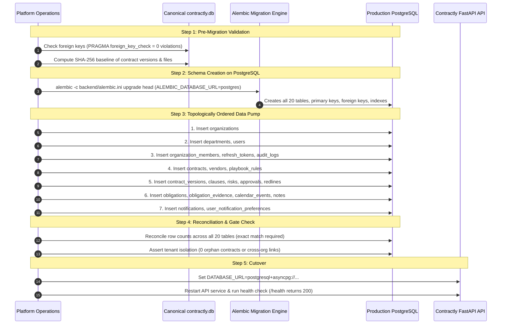

# Contractly: PostgreSQL Production Migration Plan & Schema Reference

**Document Version:** 1.0  
**Target Environment:** Managed PostgreSQL 16 (e.g. AWS RDS Aurora PostgreSQL, Supabase, Neon)  
**ORM / Driver:** SQLAlchemy 2.0 (Async) + `asyncpg>=0.29.0`  
**Migration Tooling:** Alembic (Async runner in `backend/alembic/`)  

---

## 1. Executive Summary

This document establishes the safe, non-destructive migration roadmap for transitioning Contractly from SQLite (`contractly.db`) to managed PostgreSQL. 

The application architecture is already asyncpg-ready:
- [`backend/app/core/database.py`](file:///a:/Soft%20Computing/backend/app/core/database.py) conditionally applies PostgreSQL connection pooling (`pool_size`, `max_overflow`, `pool_timeout`, `pool_recycle`, `pool_pre_ping`).
- [`backend/alembic/versions/0001_initial_schema.py`](file:///a:/Soft%20Computing/backend/alembic/versions/0001_initial_schema.py) establishes the authoritative, reversible baseline covering all 20 existing models.
- All primary keys use deterministic UUID strings (`String(36)`), avoiding auto-increment sequence collisions.

---

## 2. PostgreSQL-Specific Data Type & Behavior Harmonization

| Category | SQLite Behavior | PostgreSQL Requirement | Action Required Before Cutover |
| :--- | :--- | :--- | :--- |
| **Timestamps** | Stored as ISO-8601 strings in `TEXT`. SQLite disregards timezone offsets. | `TIMESTAMP WITH TIME ZONE` (TIMESTAMPTZ) | Update `backend/app/models/base.py` to use `Column(DateTime(timezone=True), default=utc_now)`. |
| **Booleans** | Stored as integer `0` or `1`. | Native `BOOLEAN` (`TRUE` / `FALSE`) | Data export script must explicitly cast integers `0`/`1` to boolean values before inserting into PostgreSQL. |
| **String Lengths** | SQLite ignores `VARCHAR(n)` limits; accepts arbitrary lengths. | PostgreSQL strictly enforces `VARCHAR(n)`; throws errors on overflow. | Pre-migration data audit script must assert all existing strings fit column bounds (e.g. `slug <= 100`, `title <= 500`). |
| **Foreign Keys** | SQLite disables foreign key constraints by default unless PRAGMA is run. | PostgreSQL enforces foreign keys on every insert/update/delete. | Verified: SQLite database has **0 foreign key violations**. Insertion into PostgreSQL must follow topological dependency order. |
| **Case Sensitivity** | SQLite `LIKE` is case-insensitive for ASCII characters. | PostgreSQL `LIKE` is strictly case-sensitive. | Ensure search and query filters use `func.lower()` or `.ilike()` where case-insensitive matching is expected. |

---

## 3. Safe Dual-Phase Migration Sequence



---

## 4. Post-Migration Verification Queries

### 4.1 Row Count Reconciliation
Execute on both SQLite and PostgreSQL. The counts must match identically:

```sql
SELECT 'organizations' AS tbl, count(*) FROM organizations UNION ALL
SELECT 'departments', count(*) FROM departments UNION ALL
SELECT 'users', count(*) FROM users UNION ALL
SELECT 'organization_members', count(*) FROM organization_members UNION ALL
SELECT 'contracts', count(*) FROM contracts UNION ALL
SELECT 'contract_versions', count(*) FROM contract_versions UNION ALL
SELECT 'contract_clauses', count(*) FROM contract_clauses UNION ALL
SELECT 'contract_risks', count(*) FROM contract_risks UNION ALL
SELECT 'contract_approval_steps', count(*) FROM contract_approval_steps UNION ALL
SELECT 'contract_redlines', count(*) FROM contract_redlines UNION ALL
SELECT 'refresh_tokens', count(*) FROM refresh_tokens UNION ALL
SELECT 'audit_logs', count(*) FROM audit_logs UNION ALL
SELECT 'obligations', count(*) FROM obligations UNION ALL
SELECT 'obligation_evidence', count(*) FROM obligation_evidence UNION ALL
SELECT 'calendar_events', count(*) FROM calendar_events UNION ALL
SELECT 'contract_notes', count(*) FROM contract_notes UNION ALL
SELECT 'vendors', count(*) FROM vendors UNION ALL
SELECT 'playbook_rules', count(*) FROM playbook_rules UNION ALL
SELECT 'notifications', count(*) FROM notifications UNION ALL
SELECT 'user_notification_preferences', count(*) FROM user_notification_preferences;
```

### 4.2 Multi-Tenant Integrity Assertion
Ensure no contracts or obligations belong to invalid organizations:
```sql
SELECT count(*) AS orphan_contracts FROM contracts c 
LEFT JOIN organizations o ON c.organization_id = o.id WHERE o.id IS NULL;

SELECT count(*) AS orphan_obligations FROM obligations ob 
LEFT JOIN contracts c ON ob.contract_id = c.id WHERE c.id IS NULL;
```
*Expected Result: 0 orphan rows.*

---

## 5. Rollback Criteria & Plan

### Rollback Triggers:
1. Row count mismatch on any table after data pump.
2. Foreign key violation during topological data transfer.
3. `/health` connectivity check fails or returns degraded status.
4. Any regression in contract download or tenant isolation tests during staging validation.

### Rollback Execution:
1. Revert `DATABASE_URL` in environment configuration back to `sqlite+aiosqlite:///{CANONICAL_DB_PATH}`.
2. Restart FastAPI application processes.
3. Verify `/health` reports `status: "healthy"` and database connectivity returns `healthy`.
4. Original `contractly.db` remains unaltered and authoritative.
