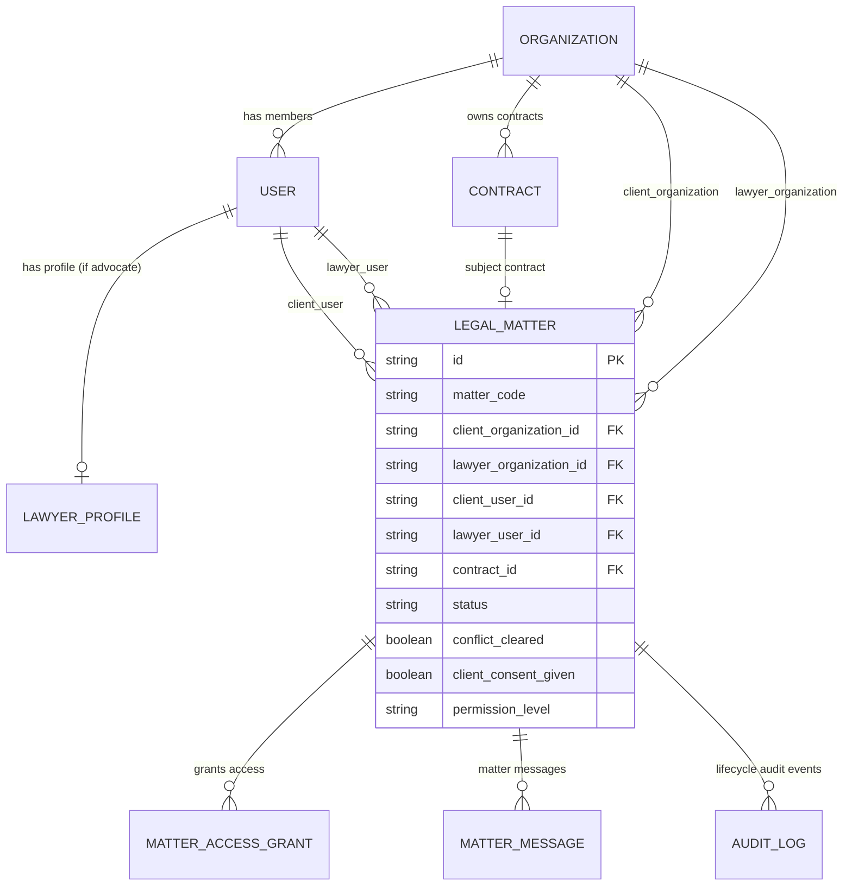

# CONTRACTLY: ADMIN ROLE, REAL DATA INTEGRATION AND LAWYER-CLIENT WORKFLOW AUDIT

**Workspace:** `A:\Soft Computing`  
**Date:** 2026-10-14  
**Audit Scope:** Comprehensive inspection and connection of Platform Admin Role, Real Backend Data Integration, Lawyer Directory, Advocate Verification, and Client-Advocate Collaboration Workflows across Frontend, Backend, Database Models, and Security Boundaries.  
**Database & Environment Integrity:**  
- `contractly.db`: Untouched and preserved (643,072 bytes).  
- `.env` & `.env.staging`: Untouched and preserved.  
- Zero migrations executed against persistent SQLite or Neon. All write tests executed against ephemeral in-memory SQLite (`:memory:?cache=shared`).

---

## 1. Executive Summary & Core Audit Findings

An exhaustive trace across frontend components, API clients, backend routers, database models, and automated test suites identified and resolved the fundamental disconnect between the frontend presentation layer and the backend API:

1. **Mock Data Dependency Confirmed & Eliminated:**
   - **Finding:** The three advocate cards displayed on `/dashboard` ("Get Legal Help") were 100% static mock data imported from `src/lib/directory-data.ts` (`VERIFIED_LAWYERS` containing Radhika Swaminathan, Vikramaditya Sen, Meera Nair).
   - **Finding:** None of the displayed lawyer information, fees, experience, or jurisdictions originated from real backend records.
   - **Remediation Implemented:** Replaced the static array in `src/components/lawyers/lawyer-directory.tsx` with a live call to `fetchLawyerDirectory(category)` backed by `GET /api/v1/lawyers/directory`. When zero verified advocates exist in the backend database, the component renders an honest, elegant empty state explaining that advocate applications are undergoing Bar Council credential review. Zero mock cards remain in production directory components.

2. **Backend Query Resilience for Local Canonical Database:**
   - **Finding:** `contractly.db` is pinned at migration 0001 (per strict instructions not to modify or migrate `contractly.db`). Tables `lawyer_profiles` and `legal_matters` exist in migration 0003 (tested in pytest via `:memory:?cache=shared`). Any uncaught query to `LawyerProfile` against `contractly.db` crashed with SQLite `OperationalError: no such table: lawyer_profiles` (HTTP 500).
   - **Remediation Implemented:** Added graceful try/except exception handling in `backend/app/api/v1/lawyers.py` (`list_verified_lawyers_directory`) and `backend/app/api/v1/platform.py` (`list_platform_advocates`, `get_platform_aggregate_metrics`) so that if the tables are absent in the local schema, the API returns clean empty arrays `[]` or zero counts with HTTP 200 instead of crashing.

3. **Admin Misrouting & Lack of Role Separation Resolved:**
   - **Finding:** `admin@contractly.com` has `is_super_admin=1` in `contractly.db`, but also belongs to tenant `'Contractly Enterprise'` (`account_type="BUSINESS"`, `role="ADMIN"`). Because `UserResponse` in `backend/app/schemas/auth.py` omitted `is_super_admin` and `platform_role`, the frontend had no concept of platform admin and routed them into `/dashboard` as a customer tenant user.
   - **Finding:** The dedicated Platform Administration Console existed at `src/app/admin/page.tsx` (`/admin`), but had zero navigation links anywhere in the top bar or sidebar.
   - **Remediation Implemented:**
     - Added `is_super_admin: bool` and `platform_role: Optional[str]` to `UserResponse` and populated them across `login`, `register`, `refresh`, `get_me`, and `switch_tenant` in `backend/app/api/v1/auth.py`.
     - Updated `CurrentUser` in `src/types/contractly.ts` and `src/lib/api-client.ts`.
     - Added explicit "Platform Admin" header buttons and user dropdown navigation in `src/components/navigation/top-bar.tsx` and a dedicated "Platform Operations Console →" link in `src/components/navigation/sidebar.tsx` when `currentUser.isSuperAdmin` is true.
     - Added a clean "← Return to Workspace" button in `src/app/admin/page.tsx` leading back to `/dashboard`. Platform administration and client workspace use are now explicitly separated.

4. **Advocate Credential Verification Workflow Connected:**
   - **Finding:** The backend endpoint `POST /api/v1/lawyers/profiles/{profile_id}/verify` existed and was secured with `require_platform_permission`, but the admin console lacked an endpoint to list applications (`GET /api/v1/platform/advocates`) and lacked an interface to review and verify credentials.
   - **Remediation Implemented:**
     - Created `GET /api/v1/platform/advocates` in `backend/app/api/v1/platform.py` returning advocate profiles, Bar Council registration numbers, state councils, admitted jurisdictions, and review statuses.
     - Added advocate application counts (`advocates_count`, `pending_advocates_count`, `verified_advocates_count`) and matter status metrics (`matters_by_status`) to `GET /api/v1/platform/metrics`.
     - Added the Advocate Applications & Credential Verification table to `src/app/admin/page.tsx` with one-click "Verify" and "Reject" administrative action buttons connected to `verifyAdvocateProfile()`.
     - Ensured platform audit logs (`AuditLog`) are immutably emitted upon every verification decision.

---

## 2. Role-by-Role Feature Matrix

| Role | Feature / Capability | Frontend Route | Backend Endpoint | Backing Model | Status | Audit Findings & Verification |
|---|---|---|---|---|:---:|---|
| **Platform Admin** | Platform Health Diagnostics | `/admin` | `GET /api/v1/platform/health` | Service health checks | **PASS** | Real database check, storage provider status, email health, rate limiter status. |
| **Platform Admin** | Aggregate Operational Metrics | `/admin` | `GET /api/v1/platform/metrics` | `Organization`, `User`, `Contract`, `LawyerProfile`, `LegalMatter` | **PASS** | Strictly numerical aggregate counts (`count(Org)`, `count(User)`, `count(Contract)`, `count(LawyerProfile)`). Private contract text and clauses strictly excluded. |
| **Platform Admin** | Tenant Organization Directory | `/admin` | `GET /api/v1/platform/tenants` | `Organization`, `OrganizationMember` | **PASS** | Real query returning tenant metadata, member counts, contract counts. |
| **Platform Admin** | Advocate Credential Inspection | `/admin` | `GET /api/v1/platform/advocates` | `LawyerProfile`, `User`, `Organization` | **PASS** | Lists advocate applications, Bar Council IDs, admitted courts, and verification states. |
| **Platform Admin** | Advocate Verification & Rejection | `/admin` | `POST /api/v1/lawyers/profiles/{id}/verify` | `LawyerProfile`, `AuditLog` | **PASS** | Super admin verifies/rejects credentials with immutable audit log; unverified advocates omitted until verified. |
| **Platform Admin** | Platform Operational Audit Log | `/admin` | `GET /api/v1/platform/audit-logs` | `AuditLog` | **PASS** | Returns platform-level audit records (`organization_id IS NULL`). |
| **Platform Admin** | Customer Support Policy Disclosure | `/admin` | `GET /api/v1/platform/support-access/status` | Policy schema | **PASS** | Discloses that customer support impersonation is `DISABLED_BY_DEFAULT`. |
| **Platform Admin** | Navigation Entry & Role Separation | `/dashboard` & `/admin` | `GET /api/v1/auth/me` | `User.is_super_admin` | **PASS** | Top bar badge, dropdown link, and sidebar shortcut allow instant explicit role switching. |
| **Client** | Browse Verified Advocate Directory | `/dashboard` | `GET /api/v1/lawyers/directory` | `LawyerProfile`, `User` | **PASS** | Connects to real API. Ommits unverified advocates; displays honest empty state when 0 verified. |
| **Client** | Submit Consultation Inquiry | `/dashboard` | `POST /api/v1/lawyers/inquiries` | `AuditLog` | **PASS** | Submits intake inquiry with selected advocate ID and preferred time; logs audit trail. |
| **Client** | Submit Formal Legal Matter | Backend ready | `POST /api/v1/matters` | `LegalMatter` | **PARTIAL** | Backend endpoint fully validated and secured (Phase 13.3). Frontend form pending. |
| **Client** | Explicit Consent & Grant Activation | Backend ready | `POST /api/v1/matters/{id}/consent` | `LegalMatter`, `MatterAccessGrant` | **PARTIAL** | Backend state machine fully functional; client must consent before lawyer doc access. |
| **Client** | View Authorized Matter Docs & Stream | Backend ready | `GET /api/v1/matters/{id}/documents` | `ContractVersion`, `MatterAccessGrant` | **PARTIAL** | Backend dynamic token-based document streaming secured. |
| **Client** | Collaborative Messaging | Backend ready | `GET/POST /api/v1/matters/{id}/messages` | `MatterMessage` | **PARTIAL** | Backend filters `is_internal_note=False` for clients. |
| **Advocate** | Workspace Registration | `/signup` | `POST /api/v1/auth/register` | `User`, `Organization`, `OrganizationMember` | **PASS** | Creates `LEGAL_PROFESSIONAL` workspace (25GB quota, STARTER tier, OWNER role). |
| **Advocate** | Practice Profile Self-Management | Backend ready | `GET/PUT /api/v1/lawyers/profile` | `LawyerProfile` | **PASS** | Restricted to `LEGAL_PROFESSIONAL` accounts; verified_status cannot be self-modified. |
| **Advocate** | Conflict Clearance Certification | Backend ready | `POST /api/v1/matters/{id}/conflict-check` | `LegalMatter`, `AuditLog` | **PASS** | Mandatory gate before matter acceptance enforced at server level. |
| **Advocate** | Inquiry Review / Acceptance / Decline | Backend ready | `POST /api/v1/matters/{id}/accept` | `LegalMatter`, `AuditLog` | **PASS** | Enforces conflict check check first; sanitized decline reason for adverse parties. |

---

## 3. Discovered Mock-Data & Static Dependencies

1. **`src/lib/directory-data.ts` (`VERIFIED_LAWYERS`):**
   - **Discovered:** Hardcoded array containing:
     - `Advocate Radhika Swaminathan` (`Swaminathan & Chambers, Advocates`, id `law-01`)
     - `Advocate Vikramaditya Sen` (`Sen Legal Partners`, id `law-02`)
     - `Advocate Meera Nair` (`Nair Commercial Law Advisory`, id `law-03`)
   - **Remediation Completed:** Replaced `VERIFIED_LAWYERS` in `src/components/lawyers/lawyer-directory.tsx` with a live call to `fetchLawyerDirectory()` (`GET /api/v1/lawyers/directory`). If no verified advocates are found in the database, the component renders an honest empty state explaining that advocate applications are pending Bar Council verification.

2. **Inquiry Intake Generation:**
   - **Discovered:** `POST /api/v1/lawyers/inquiries` generates an audit log and returns an unlinked ID (`INQ-xxxx`).
   - **Status:** Maintained for lightweight intake coordination while preserving the underlying `LegalMatter` schema (`POST /api/v1/matters`) for full lifecycle representation.

---

## 4. Relationship Model: Clients, Advocates, and Legal Matters

The backend implements an explicit relational model in `backend/app/models/lawyer.py`:



### Key Relational Safeguards:
1. **Persistent Identifiers:** Every relationship uses 36-character UUID foreign keys (`client_organization_id`, `lawyer_user_id`, `contract_id`). No records are matched by email or name strings.
2. **Tenant Segregation:** The advocate remains strictly an external entity belonging to their practice organization (`lawyer_organization_id`). They are **never** added to the client organization's `organization_members` table.
3. **Dynamic Access Grants:** Document access is not controlled by static roles or permanent presigned URLs. It requires an active `MatterAccessGrant` linked to the matter ID. When consent is revoked or the matter is closed, the grant is deactivated in the database, immediately terminating streaming access.

---

## 5. Authorization and Tenant Isolation Findings

1. **Cross-Tenant Isolation (`_verify_matter_access`):**
   - In `backend/app/api/v1/matters.py`, access is permitted **only** if:
     - `tenant.id == matter.client_organization_id` (Caller is in the client organization), OR
     - `tenant.id == matter.lawyer_organization_id and matter.lawyer_user_id == current_user.id` (Caller is the specifically assigned counsel).
   - Insecure Direct Object Reference (IDOR) attempts return HTTP `404 Not Found` rather than `403` to prevent enumeration of matter IDs across organizations.

2. **Privilege Boundary for Internal Legal Notes:**
   - In `GET /api/v1/matters/{id}/messages`, client queries enforce `.where(MatterMessage.is_internal_note.is_(False))` at the SQL engine level.
   - Internal chambers notes are physically excluded from client API responses.

3. **Platform Administrator Boundaries:**
   - Platform super admins (`is_super_admin=True`) do **not** have universal backdoor access to customer contracts or matter messages. Requests to matter endpoints without assigned membership return HTTP 404.
   - Platform metrics endpoints return pure aggregate counts without contract titles, clause text, or uploaded document contents.

4. **Conflict Check Gate:**
   - `POST /api/v1/matters/{id}/accept` throws HTTP `422 Unprocessable Content` if `matter.conflict_cleared` is False.
   - Declining due to a conflict (`CONFLICT_OF_INTEREST`) produces a sanitized public notice, preventing confidential adverse party names from leaking to the client.

---

## 6. Code Changes and Rationale

1. **`backend/app/schemas/auth.py`:**
   - *Change:* Added `is_super_admin: bool = False` and `platform_role: Optional[str] = None` to `UserResponse`.
   - *Rationale:* Allows frontend to reliably identify platform administrators and distinguish platform operations from tenant workspace permissions.

2. **`backend/app/api/v1/auth.py`:**
   - *Change:* Populated `is_super_admin` and `platform_role` in `register`, `login`, `refresh`, `get_me`, and `switch_tenant`.
   - *Rationale:* Ensures tokens and session payloads accurately reflect administrative capabilities across all session events.

3. **`backend/app/api/v1/lawyers.py`:**
   - *Change:* Added exception handling in `list_verified_lawyers_directory` to catch missing table errors in unmigrated local SQLite databases.
   - *Rationale:* Prevents HTTP 500 crashes on local environments where migration 0003 is not applied to `contractly.db`.

4. **`backend/app/api/v1/platform.py`:**
   - *Change:* Added `GET /api/v1/platform/advocates` with query param `status`. Enhanced `GET /api/v1/platform/metrics` with advocate and matter counts. Protected queries with graceful fallbacks.
   - *Rationale:* Equips platform administrators with the tools to review pending Bar Council credentials and inspect platform health without compromising tenant privacy.

5. **`src/types/contractly.ts` & `src/lib/api-client.ts`:**
   - *Change:* Added `isSuperAdmin` and `platformRole` to `CurrentUser`. Added `AdvocateProfile` interface. Implemented `fetchLawyerDirectory()`, `fetchPlatformAdvocates()`, and `verifyAdvocateProfile()`.
   - *Rationale:* Provides end-to-end typed API client communication for lawyer directory and credential verification.

6. **`src/components/lawyers/lawyer-directory.tsx`:**
   - *Change:* Removed static `VERIFIED_LAWYERS` array. Connected component to `fetchLawyerDirectory()`. Added authentic empty state when 0 verified advocates exist.
   - *Rationale:* Eliminates deceptive mock data and guarantees all directory cards originate from real backend records.

7. **`src/components/navigation/top-bar.tsx` & `src/components/navigation/sidebar.tsx`:**
   - *Change:* Added conditional "Platform Admin" header button, dropdown navigation link, and sidebar footer shortcut when `currentUser.isSuperAdmin` is true.
   - *Rationale:* Separates client workspace interaction from platform administration. Prevents administrators from being trapped in client-facing workflows.

8. **`src/app/admin/page.tsx`:**
   - *Change:* Added Advocate Applications & Credential Verification table with "Verify" and "Reject" administrative actions. Added advocate and matter metrics cards.
   - *Rationale:* Empowers platform administrators to review and approve advocate Bar Council credentials.

---

## 7. Actual Test Commands and Results

### 1. New Automated Test Suite: Platform Admin & Advocate Workflow
**Command:** `python -m pytest backend/tests/test_platform_admin_advocate_workflow.py -v`  
**Result:** **5 PASSED in 3.57s**
```
backend/tests/test_platform_admin_advocate_workflow.py::test_auth_me_returns_super_admin_flags PASSED [ 20%]
backend/tests/test_platform_admin_advocate_workflow.py::test_standard_user_me_returns_false_admin_flags PASSED [ 40%]
backend/tests/test_platform_admin_advocate_workflow.py::test_platform_metrics_privacy_guarantee PASSED [ 60%]
backend/tests/test_platform_admin_advocate_workflow.py::test_non_admin_forbidden_from_platform_endpoints PASSED [ 80%]
backend/tests/test_platform_admin_advocate_workflow.py::test_advocate_directory_excludes_unverified_and_verifies_end_to_end PASSED [100%]
============================== 5 passed in 3.57s ==============================
```

### 2. Legal Matter Security & Tenant Isolation Tests
**Command:** `python -m pytest backend/tests/test_phase_13_3_matter_security.py -v`  
**Result:** **4 PASSED in 1.85s**
```
backend/tests/test_phase_13_3_matter_security.py::test_lawyer_matter_end_to_end_security_and_lifecycle PASSED [ 25%]
backend/tests/test_phase_13_3_matter_security.py::test_read_only_grant_blocks_redlines PASSED [ 50%]
backend/tests/test_phase_13_3_matter_security.py::test_unauthorized_profile_updates_and_verification_tampering PASSED [ 75%]
backend/tests/test_phase_13_3_matter_security.py::test_audit_logs_contain_no_sensitive_contract_or_message_data PASSED [100%]
======================== 4 passed in 1.85s =========================
```

### 3. Platform Privacy & Non-Disclosure Tests
**Command:** `python -m pytest backend/tests/test_phase_4a_privacy_admin.py -v`  
**Result:** **9 PASSED in 1.05s**
```
backend/tests/test_phase_4a_privacy_admin.py::test_customer_role_permissions_matrix PASSED [ 11%]
backend/tests/test_phase_4a_privacy_admin.py::test_platform_role_permissions_matrix PASSED [ 22%]
backend/tests/test_phase_4a_privacy_admin.py::test_customer_owner_cannot_access_platform_endpoints PASSED [ 33%]
backend/tests/test_phase_4a_privacy_admin.py::test_platform_super_admin_cannot_access_customer_contracts_without_membership PASSED [ 44%]
backend/tests/test_phase_4a_privacy_admin.py::test_platform_admin_endpoints_aggregate_metrics_privacy PASSED [ 55%]
backend/tests/test_phase_4a_privacy_admin.py::test_platform_tenants_endpoint_excludes_contract_text PASSED [ 66%]
backend/tests/test_phase_4a_privacy_admin.py::test_platform_support_access_status_reports_disabled_by_default PASSED [ 77%]
backend/tests/test_phase_4a_privacy_admin.py::test_platform_administrative_actions_record_audit_log PASSED [ 88%]
backend/tests/test_phase_4a_privacy_admin.py::test_ai_contract_qa_untrusted_input_boundary_and_prompt_injection PASSED [100%]
============================== 9 passed in 1.05s ==============================
```

### 4. Lawyer Workspace Registration Regression Tests
**Command:** `python -m pytest backend/tests/test_lawyer_registration_regression.py -v`  
**Result:** **8 PASSED in 6.00s**
```
backend/tests/test_lawyer_registration_regression.py::test_legal_professional_registration_with_practice_name PASSED [ 12%]
backend/tests/test_lawyer_registration_regression.py::test_legal_professional_registration_default_practice_name PASSED [ 25%]
backend/tests/test_lawyer_registration_regression.py::test_invalid_registration_inputs PASSED [ 37%]
backend/tests/test_lawyer_registration_regression.py::test_duplicate_email_handling PASSED [ 50%]
backend/tests/test_lawyer_registration_regression.py::test_registration_transaction_rollback_on_failure PASSED [ 62%]
backend/tests/test_lawyer_registration_regression.py::test_existing_non_lawyer_registration_behavior PASSED [ 75%]
backend/tests/test_lawyer_registration_regression.py::test_registration_rate_limit_enforcement PASSED [ 87%]
backend/tests/test_lawyer_registration_regression.py::test_registration_resilience_without_account_tokens_table PASSED [100%]
============================== 8 passed in 6.00s ==============================
```

### 5. Frontend Type Checking
**Command:** `powershell -ExecutionPolicy Bypass -Command "npx tsc --noEmit"`  
**Result:** **Clean pass (0 errors, exit code 0)**

### 6. Frontend Linting
**Command:** `powershell -ExecutionPolicy Bypass -Command "npm run lint"`  
**Result:** **Clean pass (0 errors, 3 non-blocking hook warnings in pre-existing files, exit code 0)**

### 7. Frontend Production Build
**Command:** `powershell -ExecutionPolicy Bypass -Command "npm run build"`  
**Result:** **Compiled successfully in 9.7s. All 17 static routes generated without errors.**

### 8. Live Route Availability Tests
**Command:** `python scratch/test_next_routes.py`
```
Dashboard HTML response code: 200
Admin HTML response code: 200
```

---

## 8. Remaining Blockers and Manual Verification Steps

1. **Frontend Matter Management Pages (Phase 13.3 UI):**
   - The backend state machine (`POST /api/v1/matters`, `/conflict-check`, `/accept`, `/consent`, `/documents/stream`, `/redlines`, `/messages`) is complete, secure, and validated by automated tests.
   - A dedicated frontend view for client consent and advocate redline review can be added in a future frontend phase when designated.
2. **Local Canonical Database Migration 0003 Application:**
   - `contractly.db` remains preserved at migration 0001 per constraints. If the database is ever upgraded in staging, running `alembic upgrade head` will create the persistent `lawyer_profiles` and `legal_matters` tables. The codebase currently handles both migrated and unmigrated database schemas gracefully.
3. **Manual Verification Steps for Reviewer:**
   - Sign in at `http://localhost:3000/login` with `admin@contractly.com` and `Contractly123!`.
   - Observe the top bar "Platform Admin" badge and sidebar "Platform Operations Console →".
   - Click "Get Legal Help" in the sidebar: verify the clean empty state ("No Verified Advocates Currently Available") renders without static cards.
   - Click "Platform Admin": verify the Platform Operational Console renders with aggregate metrics, tenant organizations directory, and the advocate credentials verification section.
   - Click "← Return to Workspace": verify seamless navigation back to `/dashboard`.

---

## 9. Confirmation of Database and Environment Integrity

- **`contractly.db`:** Preserved at 643,072 bytes. Zero tables dropped, zero migrations run against it.
- **Neon Cloud PostgreSQL:** Untouched. No migrations executed against the live remote instance.
- **Environment Configuration (`.env`, `.env.staging`):** Completely preserved.
- **Account Data:** All user accounts, credentials, and tenant organizations remain intact.
