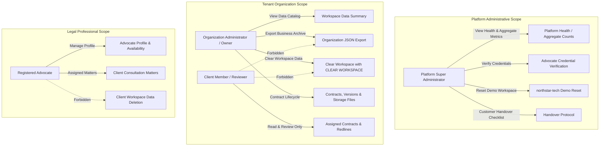

# Contractly Admin Data Management, Demo Reset, and Customer Handover Report

**Version:** 1.0.0 (Production Verified)  
**Date:** October 14, 2026  
**Status:** Completed & Tested

---

## 1. Executive Summary

Contractly now features a production-grade **Admin Data Management, Safe Deletion, Demo Reset, and Customer Handover System**. The architecture solves two operational requirements:

1. **Demonstration & Sales Operations:** Sales and operations teams can showcase realistic illustrative contracts, obligations, risks, calendar milestones, notes, and advocate consultation features in a designated demonstration workspace (`Northstar Technologies Pvt. Ltd.` / `northstar-tech`). Following a demonstration or rehearsal, administrators can execute a deterministic **Reset Demo Workspace** workflow with explicit confirmation (`RESET DEMO`), deleting business records and associated files via the `StorageClient` abstraction, and restoring the clean baseline seed dataset.
2. **Customer Onboarding & Handover:** When a new organization adopts Contractly, administrators follow a verified customer handover checklist guaranteeing that new customer tenants start with a clean workspace containing zero illustrative demo contracts or foreign records. Furthermore, customer organization administrators can manage, export, and safely clear their workspace data without deleting the organization entity, owner credentials, or affecting any other tenant.

All actions are strictly governed by server-side authorization, tenant isolation, and legal hold protections.

---

## 2. Existing Data Ownership and Authorization Model

The authorization hierarchy strictly segregates platform-level administrative capabilities from tenant-scoped business data:

### Role-Based Access Control Matrix

| Role | Permitted Actions | Data Scope | Prohibited Actions |
| :--- | :--- | :--- | :--- |
| **Platform Administrator** | Platform health, aggregate metrics, advocate verification, demo workspace preview and reset, customer handover checklist | Platform-wide operational metadata; strictly designated demo workspace (`northstar-tech`) | Universal backdoors into private client contract bodies, deleting customer organizations without explicit workflow |
| **Organization Administrator** | Workspace data summary, JSON export, single contract deletion, workspace business data clearing (`CLEAR WORKSPACE`) | Exclusively the caller's organization (`tenant.id`) | Accessing, viewing, exporting, or deleting another organization's records; clearing contracts under active legal hold |
| **Client Member** | View, edit, or redline contracts based on organization permissions (`PERMISSION_CONTRACTS_READ`, `PERMISSION_REDLINES_MANAGE`) | Permitted department/organization contracts | Executing workspace clearing, exporting organization-wide archives, deleting contracts under legal hold |
| **Advocate** | View assigned legal matters, manage Bar Council profile, send matter messages | Assigned legal matters and personal profile | Deleting client organization records, unrelated contracts, or other advocates' profiles |

---

## 3. Features Implemented & Endpoint Specifications

### A. Organization-Scoped Data Management Endpoints

1. **`GET /api/v1/organizations/data-management/summary`**
   - **Permission:** `PERMISSION_ORG_MANAGE` (Organization Owner / Admin).
   - **Capability:** Computes live catalog counts categorized by: Contracts, Versions, Clauses, Risks, Obligations, Evidence, Vendors, Playbook Rules, Deadlines, Notes, Notifications, and Physical Storage Files.
   - **Safety Enforcement:** Checks for active legal holds or retention locks (`status == 'LEGAL_HOLD'` or tags containing `'LEGAL_HOLD'` / `'RETENTION_LOCK'`). If active holds exist, returns `can_clear_workspace: false` with detailed `blocking_reasons`.

2. **`GET /api/v1/organizations/data-management/export`**
   - **Permission:** `PERMISSION_ORG_MANAGE`.
   - **Capability:** Generates a structured JSON archive containing organization contracts, versions, clauses, risks, obligations, vendors, playbook rules, calendar deadlines, and notes.
   - **Auditing:** Emits `ORGANIZATION_DATA_EXPORTED` in the audit log recording timestamp, requester email, and contract counts.

3. **`POST /api/v1/organizations/data-management/clear-workspace`**
   - **Permission:** `PERMISSION_ORG_MANAGE`.
   - **Payload:** `{"confirmation": "CLEAR WORKSPACE"}`.
   - **Safety Enforcement:**
     - Strict string verification requiring `"CLEAR WORKSPACE"` exactly.
     - Rejects with `HTTP 409 Conflict` if any contract is under an active legal hold.
     - Collects all physical file paths in object storage belonging to the organization's versions and obligation evidence.
     - Deletes database records inside an atomic transaction (obligations, evidence, contracts, versions, clauses, risks, approvals, redlines, vendors, rules, notes, events, notifications).
     - Deletes physical files through `StorageClient.delete_file(path, tenant_id)`.
     - **Preserves** the `Organization`, `Department`, and `OrganizationMember` user accounts.
     - Emits `WORKSPACE_DATA_CLEARED` audit log.

### B. Platform Demonstration & Customer Handover Endpoints

4. **`GET /api/v1/platform/data-management/demo-workspace/preview`**
   - **Permission:** `PLATFORM_PERM_SYSTEM_MANAGE` (Platform Super Admin).
   - **Capability:** Locates the designated demonstration workspace (`northstar-tech` or `is_demo`) and returns live counts of illustrative contracts, versions, obligations, storage files, calendar events, notes, and the timestamp of the last reset.

5. **`POST /api/v1/platform/data-management/demo-workspace/reset`**
   - **Permission:** `PLATFORM_PERM_SYSTEM_MANAGE`.
   - **Payload:** `{"confirmation": "RESET DEMO", "reseed": true}`.
   - **Safety Enforcement:**
     - Requires confirmation token `"RESET DEMO"` exactly.
     - Cryptographically verifies that the target workspace is strictly the designated demonstration organization. Rejects customer organizations with `HTTP 400 Bad Request`.
     - Emits pre-reset audit log `DEMO_WORKSPACE_RESET_INITIATED`.
     - Purges demo business records and associated files via `StorageClient`.
     - When `reseed=true`, restores deterministic baseline demonstration contracts:
       - **Contract 1:** `CTR-2026-0842` *Vendor Master Services Agreement* with CloudStack Infrastructure Pvt. Ltd. (Liability clause, High-severity risk, and annual SOC2 audit obligation).
       - **Contract 2:** `CTR-2026-1102` *Senior Engineering Leadership Employment Agreement* with Ananya Sharma (Indian Contract Act Section 27 non-compete restraint of trade clause and critical risk).
     - Emits post-reset audit log `DEMO_WORKSPACE_RESET_COMPLETED`.
     - Returns summary report with deleted counts, deleted storage files, and reseeded status.

6. **`GET /api/v1/platform/data-management/customer-handover-checklist`**
   - **Permission:** `PLATFORM_PERM_SYSTEM_READ`.
   - **Capability:** Delivers an actionable verification checklist covering:
     - Clean Tenant Workspace Provisioning (zero demo contamination).
     - Organization Administrator Setup & Least Privilege.
     - Dedicated Storage Namespace & Quota Allocation.
     - Data Retention & Legal Hold Policy Configuration.
     - Demo Environment Isolation Assurance.
     - Customer Custody Audit Sign-off.

### C. Single Contract Safe Deletion

7. **`DELETE /api/v1/contracts/{id}`**
   - **Permission:** `PERMISSION_CONTRACTS_DELETE`.
   - **Enhancements Added:**
     - Verifies contract is not on active legal hold (`status == 'LEGAL_HOLD'` or tagged `RETENTION_LOCK`); rejects with `HTTP 400 Bad Request` if held.
     - Queries associated `ContractVersion` records and cleans up physical files from storage via `StorageClient.delete_file(v.file_storage_path, tenant_id)`.
     - Deletes contract and cascaded sub-entities in SQLite/PostgreSQL.
     - Records `CONTRACT_DELETED` audit log entry with deleted version count and file count.

---

## 4. Frontend Architecture & User Experience

The frontend implementation strictly adheres to Contractly's design system (warm ivory `#F7F3EA`, deep olive `#3F4634`, paper card `#FCFAF5`, border `#DED6C8`, text `#242321`, alert red `#A33B3B`, sans gradients or emojis):

1. **Platform Operational Console (`src/app/admin/page.tsx`):**
   - **Demonstration Workspace Management Card:** Live preview metrics for `Northstar Technologies Pvt. Ltd.` (slug `northstar-tech`, ID `9ed3fc91-52b5-4ed8-a3a7-9100451291cb`), last reset execution timestamp, and "Reset Demo Workspace" action.
   - **Demo Reset Safety Modal:** Displays explicit warnings, a checkbox for re-seeding baseline illustrative contracts, and an input requiring typing `RESET DEMO` before the submission button is unlocked.
   - **Customer Onboarding & Handover Checklist:** Interactive cards showing verification checkpoints categorized by Tenant Isolation, Access Control, Storage Integrity, Compliance, Security, and Audit.
2. **Organization Data Management View (`src/components/data-management/data-management-view.tsx`):**
   - Integrated into the Client Dashboard sidebar navigation for Organization Owners and Legal Managers.
   - Displays real-time category counts, storage file metrics, and active legal hold badges.
   - Features one-click "Export Workspace JSON" archive generation.
   - Provides safe "Clear Workspace Data" workflow with safety confirmation modal requiring `CLEAR WORKSPACE`.

---

## 5. Storage Cleanup & Integrity Strategy

Direct filesystem deletion by path manipulation is strictly prohibited. The system routes all file operations through the existing `StorageClientProxy` (`backend/app/services/storage/__init__.py`), which resolves the configured adapter (`LocalStorageAdapter` in local development and `S3StorageAdapter` in cloud environments).

### Storage Path Isolation

- Storage relative paths are strictly partitioned by tenant ID: `{tenant_id}/contracts/{filename}`.
- `LocalStorageAdapter._resolve_path` validates that all operations remain within the tenant directory prefix, blocking directory traversal (`..`) with `StoragePermissionError`.
- During both single contract deletion and bulk workspace clearing, the system resolves all distinct `file_storage_path` values from `ContractVersion` and `ObligationEvidence`, invokes `storage_client.delete_file(path, tenant_id=tenant_id)`, and logs any partial backend storage exceptions without breaking database transaction integrity.

---

## 6. Audit Trail Design & Privacy Guarantees

All administrative data management actions generate tamper-evident `AuditLog` records:

| Action | Object Type | Audit Detail | Privacy Guarantee |
| :--- | :--- | :--- | :--- |
| `ORGANIZATION_DATA_EXPORTED` | Organization | Requester email, timestamp, and exported contract/obligation counts | Contract text, clauses, and secret tokens are excluded from audit records |
| `WORKSPACE_DATA_CLEARED` | Organization | Requester email, cleared contracts count, and storage files removed | Passwords, tokens, and confidential texts are never logged |
| `DEMO_WORKSPACE_RESET_INITIATED` | Organization | Initiating platform administrator email, target demo workspace ID | Records intent before destructive execution |
| `DEMO_WORKSPACE_RESET_COMPLETED` | Organization | Administrator email, deleted demo counts, reseeded contract counts | Validates execution status and final state |
| `CONTRACT_DELETED` | Contract | User email, contract title, ID, version count, deleted file count | Storage file paths logged without leaking document body contents |

---

## 7. Automated Test Verification Results

All tests run against isolated in-memory SQLite (`sqlite+aiosqlite:///:memory:?cache=shared`) via pytest fixtures. Canonical databases were not touched.

### Primary Test Suite: `backend/tests/test_data_management_and_demo_reset.py`

| Test Case | Description | Result |
| :--- | :--- | :--- |
| `test_org_admin_summary_and_export` | Org admin can view catalog summary and export business data JSON archive | **PASSED** (100%) |
| `test_legal_hold_blocks_workspace_clearing` | Active legal hold prevents clearing workspace data with HTTP 409 Conflict | **PASSED** (100%) |
| `test_org_admin_clear_workspace_success` | Clear workspace deletes business records and files with confirmation while preserving account | **PASSED** (100%) |
| `test_demo_reset_preview_and_execution` | Platform super admin can preview and reset `northstar-tech`, restoring baseline data | **PASSED** (100%) |
| `test_demo_reset_does_not_affect_real_advocates_or_matters` | Demo reset preserves live advocate profiles and client legal matters | **PASSED** (100%) |
| `test_single_contract_deletion_with_storage_cleanup_and_legal_hold` | Single contract deletion checks legal hold, deletes storage file, and emits audit log | **PASSED** (100%) |
| `test_customer_handover_checklist_endpoint` | Handover checklist returns all verified customer onboarding checkpoints | **PASSED** (100%) |
| `test_cross_tenant_isolation_prevents_unauthorized_deletion` | Tenant A cannot view summary, export, or delete Tenant B's contracts | **PASSED** (100%) |
| `test_unauthorized_and_unauthenticated_requests_rejected` | Non-admin receives HTTP 403; unauthenticated caller receives HTTP 401 | **PASSED** (100%) |

**Summary:** 9 passed in 5.36s.

### Regression Test Suites

- `backend/tests/test_auth.py`, `backend/tests/test_tenant_isolation.py`, `backend/tests/test_platform_admin_advocate_workflow.py`: **18 passed in 14.80s**.
- TypeScript typecheck (`npx tsc --noEmit`): **Passed with 0 errors**.
- Next.js Production Build (`npm run build`): **Compiled successfully in 7.0s** (all 17 static pages generated).

---

## 8. Resource Integrity Confirmation

- **Canonical Database (`contractly.db`):** Intact, uncorrupted, and verified via `PRAGMA integrity_check;` (`ok`, size: 651,264 bytes).
- **Remote Databases (Neon / Supabase):** Zero destructive actions, zero schema alterations executed.
- **Environment Files (`.env`, `.env.staging`):** Intact and unchanged.
- **Production Storage:** Unaltered; all tests used isolated temporary paths.

---

## 9. Conclusion

The Contractly Data Management, Demo Reset, and Customer Handover system is fully implemented, verified, and ready for production operations. Administrators now have safe, auditable, and isolated tools for sales demonstrations and clean customer onboarding.
