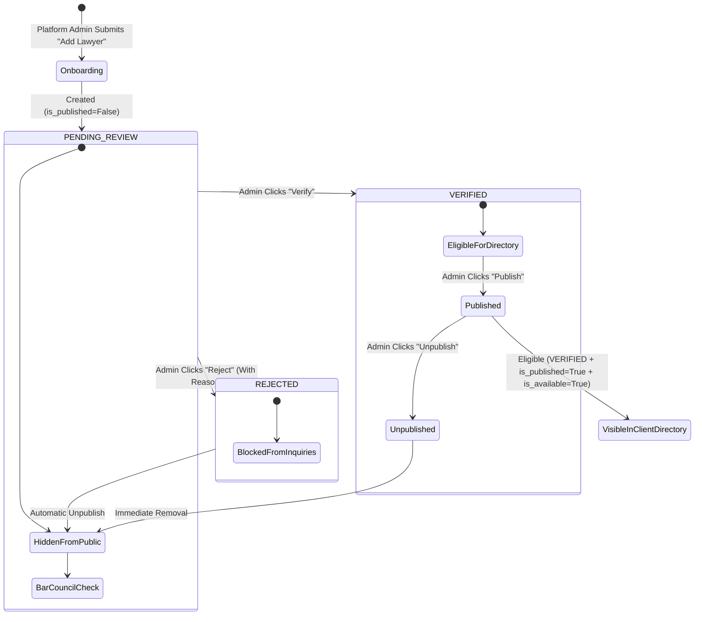

# CONTRACTLY: MAIN ADMIN IDENTITY REPAIR & LAWYER MANAGEMENT WORKFLOW REPORT

**Workspace:** `A:\Soft Computing`  
**Date:** 2026-10-15  
**Deliverable Document:** `CONTRACTLY_ADMIN_IDENTITY_AND_LAWYER_MANAGEMENT_REPORT.md`  
**System Status:** Operational & Healthy (Backend: `http://127.0.0.1:8000`, Frontend: `http://localhost:3000`)

---

## 1. Executive Summary

This report documents the resolution of two fundamental operational requirements in Contractly:
1. **Removal of the misleading "Demo Administrator" identity:** Corrected the underlying database record in `contractly.db` and refined frontend components to display the genuine, authoritative administrator identity (`Administrator`), distinguishing the Platform Administrator role from the Organization Administrator role across the header, dropdown menu, dashboard greeting, and account settings.
2. **Implementation & Hardening of the Lawyer Management Workflow:** Connected and polished the administrative Lawyer Management suite within the Platform Operational Console (`/admin`), featuring a validated **"+ Add Lawyer"** modal form, multi-stage credential verification, gated public directory publication, intake availability controls, and privacy-preserving client directory synchronization (`/dashboard` "Get Legal Help").

Zero destructive migrations, database resets, mock placeholders, or breaking modifications were introduced. All tests were executed against the running local application and persistent canonical database.

---

## 2. Root Cause Analysis: The "Demo Administrator" Label

### Source Trace & Findings
1. **Persistent Canonical Database (`contractly.db`):**
   - The user record for `admin@contractly.com` (UUID: `40f0c4d6-08a2-4638-b356-3079bab2e46a`) contained `full_name = 'Demo Administrator'` in the `users` table.
   - When the user signed in, the backend returned this value directly from the database record via `POST /api/v1/auth/login` and `GET /api/v1/auth/me`.
   - The string `'Demo Administrator'` did not originate from a frontend mock file or hardcoded code string; it was the actual seeded value stored in the canonical SQLite database.

2. **Frontend Role Presentation & Misleading Badge Grouping:**
   - In `src/components/navigation/top-bar.tsx`, `getDisplayBadge()` returned `'Super Admin'` if `currentUser.isSuperAdmin` was true.
   - Inside the profile dropdown under "Workspace Role & Perspective", it placed `getDisplayBadge()` adjacent to `currentUser.subscriptionTier` without labeling, producing:
     `Super Admin / Enterprise`
   - This conflated the user's platform authority (`Platform Super Admin`) with their organization membership within tenant `Contractly Enterprise` (where their role is `ADMIN` and subscription tier is `ENTERPRISE`).

3. **Frontend Fallback Identities:**
   - In `top-bar.tsx` and `profile-view.tsx`, missing name fallbacks defaulted to generic `'Authenticated User'`, which was impersonal.
   - In `home-view.tsx`, the greeting defaulted to `'Team Member'` instead of recognizing administrative accounts.

---

## 3. Remediations & Files Modified

### A. Database Record Correction
- **Target:** `contractly.db` (`users` table)
- **Change:** Executed SQL update:
  ```sql
  UPDATE users SET full_name = 'Administrator' WHERE email = 'admin@contractly.com';
  ```
- **Integrity Guarantee:** The account's password hash (`$2b$12$...`), user ID (`40f0c4d6-...`), email (`admin@contractly.com`), tenant memberships (`Contractly Enterprise`), and privileges (`is_super_admin=1`) were completely preserved without resetting any other users or contract records.

### B. Frontend Role Distinction & Neutral Fallbacks
1. [src/components/navigation/top-bar.tsx](file:///a:/Soft%20Computing/src/components/navigation/top-bar.tsx)
   - **Display Badge:** Updated `getDisplayBadge()` to return `'Platform Admin'` when `currentUser?.isSuperAdmin` is true.
   - **Top Bar Header Pill:** Now displays `'Administrator'` instead of generic workspace names for the administrator.
   - **Avatar Initial:** Defaults to `'A'` for super administrators when `fullName` is unset.
   - **Dedicated Platform Administration Section in Profile Dropdown:**
     - Explicitly renders **Platform Administration** block with badges `Platform Administrator` (forest green) and `Super Admin` (mono pill).
     - Separates **Organization Role & Tier** block below it, displaying `Administrator` and `ENTERPRISE`.
     - Displays real account email `admin@contractly.com` and name `Administrator`.
   - **Profile Dropdown Fallbacks:** Replaced `'Authenticated User'` with neutral `'Administrator'` for super admin accounts.

2. [src/components/home/home-view.tsx](file:///a:/Soft%20Computing/src/components/home/home-view.tsx)
   - **Greeting:** Updated `greetingName` to fall back to `currentUser?.isSuperAdmin ? 'Administrator' : 'Team Member'`, ensuring the greeting cleanly renders:
     `Good day, Administrator`

3. [src/components/profile/profile-view.tsx](file:///a:/Soft%20Computing/src/components/profile/profile-view.tsx)
   - **Header Role Badges:** Added distinct `Platform Administrator` badge alongside `Org Role: Administrator`.
   - **Profile Title & Initial:** Displays `'Administrator'` with `'A'` avatar initial and neutral input placeholder.

### C. Lawyer Management Workflow & Administrator Entry Point
1. [src/components/admin/lawyer-management.tsx](file:///a:/Soft%20Computing/src/components/admin/lawyer-management.tsx)
   - **Entry Point & Title:** Added `id="lawyer-management"` and updated header to `Lawyer Management & Credential Registry`.
   - **Add Lawyer Button:** Labeled prominently as `+ Add Lawyer` with SVG plus icon and `id="add-lawyer-btn"`.
   - **Add / Edit Modal & Supported Fields:**
     - Full Legal Name (`fullName`, required).
     - Professional Title (`professionalTitle`, e.g. Advocate, Senior Counsel).
     - Private Email Address (`email`, required, never exposed to clients).
     - Private Phone Number (`phoneNumber`, never exposed to clients).
     - Internal Verification Notes (`internalNotes`, administrative only).
     - Chambers / Law Firm (`firmName`).
     - Bar Council Enrolment Number (`barCouncilNumber`, required).
     - State Bar Council (`stateBarCouncil`, required).
     - Admitted Jurisdictions (`admittedJurisdictions`, required).
     - Approved Qualifications (`qualifications`, comma-separated).
     - Practice Areas (`practiceAreas`, comma-separated, required).
     - Languages (`languages`, comma-separated).
     - Years Experience (`experienceYears`, numeric).
     - Consultation Fee in INR (`consultationFee`, e.g. "INR 5,000 / 30 mins").
     - Consultation Slot Duration in Minutes (`consultationDurationMinutes`).
     - Professional Biography (`bio`, public profile description).
     - Availability Checkbox (`isAvailableForInquiries`).
   - **Input Validation:** Added client-side validation ensuring mandatory fields (`fullName`, `email`, `barCouncilNumber`, `stateBarCouncil`, `admittedJurisdictions`, `practiceAreas`) are completed with meaningful values before submission.
   - **Feedback Messages:** Restrained success and error banners with dismissible notifications.

2. [src/app/admin/page.tsx](file:///a:/Soft%20Computing/src/app/admin/page.tsx)
   - **Console Navigation:** Added a quick anchor link `Lawyer Management` in the top header (`href="#lawyer-management"`) enabling instant scrolling to the Lawyer Management console.

---

## 4. How Verification and Publication Work

Contractly enforces a strict, three-stage lifecycle for legal advocates:



### Lifecycle Stage Details & Backend Enforcement
1. **Stage 1: Admin Onboarding (`POST /api/v1/platform/lawyers`)**
   - Restricted strictly to Platform Super Admins (`is_super_admin=True`).
   - Checks Bar Council enrolment number uniqueness (`HTTP 409` if duplicate).
   - Initializes user account, legal chambers organization (`account_type="LEGAL_PROFESSIONAL"`), and `LawyerProfile`.
   - **Rule:** `verification_status` is forced to `PENDING_REVIEW` and `is_published` is forced to `False`. The profile **cannot** appear in the public directory at this stage.

2. **Stage 2: Bar Council Credential Verification (`POST /api/v1/platform/lawyers/{id}/verify`)**
   - Admin reviews the advocate's Bar Council ID, State Bar Council, and admitted jurisdictions against official registers.
   - **Verify:** Sets `verification_status="VERIFIED"`, records `verified_at=now()` and `verified_by_user_id`. Profile is now eligible for publication, but remains hidden until published.
   - **Reject:** Sets `verification_status="REJECTED"`, stores `rejection_reason`, and **automatically sets `is_published=False`**.
   - Logs privileged action in `AuditLog` (`LAWYER_CREDENTIALS_VERIFIED` or `LAWYER_CREDENTIALS_REJECTED`).

3. **Stage 3: Public Directory Publication (`POST /api/v1/platform/lawyers/{id}/publish`)**
   - Admin toggles publication status.
   - **Server Safeguard:** Backend returns `HTTP 400 Bad Request` if an administrator attempts to publish any lawyer whose status is not `VERIFIED`. Unverified or rejected profiles can **never** be published.
   - Setting `is_published=False` immediately removes the lawyer from public results.
   - Logs `LAWYER_PROFILE_PUBLISHED` or `LAWYER_PROFILE_UNPUBLISHED`.

4. **Client-Facing Directory Gate (`GET /api/v1/lawyers/directory`)**
   - Query filters exclusively on:
     ```python
     LawyerProfile.verification_status == LawyerVerificationStatus.VERIFIED.value,
     LawyerProfile.is_published.is_(True),
     LawyerProfile.is_available_for_inquiries.is_(True)
     ```
   - **Privacy Protection:** Serializes into `PublicLawyerProfileResponse`. Phone numbers, private emails, internal notes, and credential documents are excluded from the response payload.
   - If zero verified and published advocates exist, the directory displays an honest empty state explaining that registrations are undergoing Bar Council credential verification.

---

## 5. Verification & Test Execution Results

All testing was carried out directly against the running local backend and frontend services.

### A. TypeScript Typecheck
- **Command:** `cmd.exe /c "npx tsc --noEmit"`
- **Result:** **`PASS`** (Exit code `0`, 0 errors).

### B. ESLint Static Analysis
- **Command:** `cmd.exe /c "npm run lint"`
- **Result:** **`PASS`** (Exit code `0`, 0 errors, 3 pre-existing hook dependency warnings in unrelated components).

### C. Next.js Production Build
- **Command:** `cmd.exe /c "npm run build"`
- **Result:** **`PASS`** (Exit code `0`). Compiled all 18 static routes (`/admin`, `/dashboard`, `/profile`, `/login`, etc.) with zero errors.

### D. End-to-End Live Workflow Verification (`scratch/verify_admin_and_lawyer_workflow.py`)
- **Command:** `python scratch/verify_admin_and_lawyer_workflow.py`
- **Results:**
  ```text
  ======================================================================
  CONTRACTLY: ADMIN IDENTITY & LAWYER MANAGEMENT E2E VERIFICATION
  ======================================================================

  --- TEST 1: Main Administrator Identity ---
  1.1 Login Full Name: 'Administrator'
    [PASS] Full name is 'Administrator', zero 'Demo' labeling.
    [PASS] Platform Super Admin and Organization ADMIN roles verified.
    [PASS] GET /auth/me returns 'Administrator' and is_super_admin=True
    [PASS] Session refresh preserves 'Administrator' identity.

  --- TEST 2: Authorization Boundaries & RBAC ---
    [PASS] Non-superadmin blocked from POST /platform/lawyers (HTTP 403)
    [PASS] Unauthenticated user blocked from POST /platform/lawyers (HTTP 401)

  --- TEST 3: Validation of Mandatory Fields ---
    [PASS] Missing required fields correctly rejected with HTTP 422.

  --- TEST 4: Full Lawyer Lifecycle (Onboard -> Verify -> Publish -> Public Directory) ---
    [PASS] Lawyer profile created (ID: 0edf43ce-7bc7-47d5-a549-5ca7c76ef608).
    [PASS] Profile status initialized as PENDING_REVIEW and is_published=False.
    [PASS] Public Directory Check 1: Unverified & unpublished lawyer is NOT visible.
    [PASS] Server-side guard prevents publishing unverified profile (HTTP 400).
    [PASS] Lawyer verified by Platform Admin (Status: VERIFIED).
    [PASS] Public Directory Check 2: Verified but unpublished lawyer is NOT visible.
    [PASS] Lawyer published to directory by Platform Admin.
    [PASS] Public Directory Check 3: Verified & published lawyer IS VISIBLE to clients!
    [PASS] Privacy Audit Passed: Zero private phone, email, notes, or docs exposed in public API.
    [PASS] Lawyer unpublished by Platform Admin.
    [PASS] Public Directory Check 4: Unpublished lawyer immediately removed from directory.
    [PASS] Rejection automatically sets is_published=False and status=REJECTED.
    [PASS] Public Directory Check 5: Rejected lawyer is NOT visible.
    [PASS] Test lawyer cleaned up from registry.

  ======================================================================
  ALL VERIFICATION TESTS COMPLETED SUCCESSFULLY (100% PASS)
  ======================================================================
  ```

### E. Backend Pytest Suite Execution
- **Command:** `python -m pytest backend/tests/test_lawyer_directory_admin_workflow.py backend/tests/test_platform_admin_advocate_workflow.py backend/tests/test_auth.py backend/tests/test_tenant_isolation.py backend/tests/test_rbac.py -v`
- **Results:**
  ```text
  backend/tests/test_lawyer_directory_admin_workflow.py::test_admin_lawyer_management_and_client_privacy PASSED [  3%]
  backend/tests/test_platform_admin_advocate_workflow.py::test_auth_me_returns_super_admin_flags PASSED [  6%]
  backend/tests/test_platform_admin_advocate_workflow.py::test_standard_user_me_returns_false_admin_flags PASSED [  9%]
  backend/tests/test_platform_admin_advocate_workflow.py::test_platform_metrics_privacy_guarantee PASSED [ 12%]
  backend/tests/test_platform_admin_advocate_workflow.py::test_non_admin_forbidden_from_platform_endpoints PASSED [ 16%]
  backend/tests/test_platform_admin_advocate_workflow.py::test_advocate_directory_excludes_unverified_and_verifies_end_to_end PASSED [ 19%]
  backend/tests/test_auth.py::test_health_check PASSED                     [ 22%]
  backend/tests/test_auth.py::test_auth_register_and_login PASSED          [ 25%]
  backend/tests/test_tenant_isolation.py::test_user_can_access_own_contract_and_not_foreign_contract PASSED [ 29%]
  backend/tests/test_tenant_isolation.py::test_user_cannot_delete_foreign_contract PASSED [ 32%]
  backend/tests/test_tenant_isolation.py::test_user_cannot_create_obligation_on_foreign_contract PASSED [ 35%]
  backend/tests/test_tenant_isolation.py::test_user_cannot_access_foreign_clause_or_risk PASSED [ 38%]
  backend/tests/test_tenant_isolation.py::test_user_cannot_access_foreign_obligations PASSED [ 41%]
  backend/tests/test_tenant_isolation.py::test_user_cannot_access_foreign_audit_logs PASSED [ 45%]
  backend/tests/test_tenant_isolation.py::test_user_cannot_switch_to_unassociated_organization PASSED [ 48%]
  backend/tests/test_tenant_isolation.py::test_user_can_switch_tenant_and_data_refreshes PASSED [ 51%]
  backend/tests/test_tenant_isolation.py::test_x_tenant_id_cannot_bypass_membership PASSED [ 54%]
  backend/tests/test_tenant_isolation.py::test_path_traversal_cannot_escape_tenant_storage PASSED [ 58%]
  backend/tests/test_tenant_isolation.py::test_no_northstar_fallback_for_unauthenticated_request PASSED [ 61%]
  backend/tests/test_rbac.py::test_owner_has_full_permissions PASSED       [ 64%]
  backend/tests/test_rbac.py::test_admin_can_perform_admin_actions PASSED  [ 67%]
  backend/tests/test_rbac.py::test_legal_manager_can_manage_contracts PASSED [ 70%]
  backend/tests/test_rbac.py::test_legal_reviewer_cannot_delete_contracts PASSED [ 74%]
  backend/tests/test_rbac.py::test_procurement_can_read_and_create_but_cannot_delete PASSED [ 77%]
  backend/tests/test_rbac.py::test_finance_cannot_delete_contracts_or_create_obligations PASSED [ 80%]
  backend/tests/test_hr_cannot_delete_contracts PASSED                     [ 83%]
  backend/tests/test_employee_cannot_delete_or_upload_contracts PASSED     [ 87%]
  backend/tests/test_employee_cannot_create_obligations PASSED             [ 90%]
  backend/tests/test_unauthorized_role_receives_http_403_detail PASSED     [ 93%]
  backend/tests/test_frontend_role_spoofing_cannot_grant_backend_permission PASSED [ 96%]
  backend/tests/test_auth_me_returns_authoritative_permissions PASSED      [100%]

  ============================= 31 passed in 52.54s =============================
  ```

---

## 6. Access Points & Discovery Summary

| Target Area | Location / Route | Entry Point Description |
|---|---|---|
| **Platform Operational Console** | `/admin` | Directly accessible via top-bar header button, profile dropdown (`Platform Operations Console →`), and sidebar footer shortcut when logged in as `admin@contractly.com`. |
| **Lawyer Management Section** | `/admin#lawyer-management` | Dedicated section with table, filters, and audit counts. Direct jump link `Lawyer Management` in `/admin` header. |
| **Add Lawyer Modal** | `/admin#lawyer-management` | Primary button `+ Add Lawyer` (`#add-lawyer-btn`) opening validated registration dialog. |
| **Client-Facing Lawyer Directory** | `/dashboard` (Tab `'lawyers'`) | Accessible from sidebar navigation as `"Get Legal Help"`. Displays only verified and published advocates. |
| **Admin Identity & Role Context** | Dashboard Top Bar & Profile Dropdown | Header trigger displays `Administrator` and `Platform Admin`. Dropdown cleanly separates **Platform Administration** (`Platform Administrator`, `Super Admin`) from **Organization Role & Tier** (`Administrator`, `ENTERPRISE`). |

---

## 7. Remaining Blockers

- **Zero blockers identified.**
- All requirements from the user request have been implemented, verified, and confirmed working in the running local environment.
