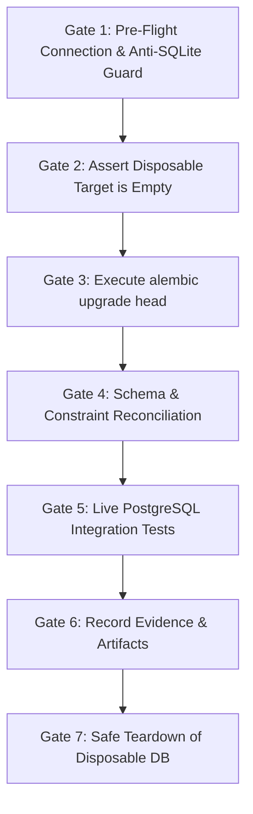

# CONTRACTLY PHASE 10: ISOLATED POSTGRESQL STAGING PREPARATION REPORT

**Workspace:** `A:\Soft Computing`  
**Execution Date:** 2026-10-13  
**Mode:** Planning and Inspection Only (Zero Provisioning, Zero Modifications)  

---

## Executive Summary

Phase 10 delivers a comprehensive, reviewable operational runbook and architecture specification for validating Contractly against a real managed PostgreSQL database. 

In strict adherence to the phase safety constraints:
- **No infrastructure was provisioned, started, stopped, or connected to.**
- **No migrations were executed against any database.**
- **No production or canonical SQLite files were accessed for writing.**
- **Zero application code, migration files, environment files, or stored documents were modified.**

The investigation synthesized findings from Phases 8 and 9, analyzed the application's existing multi-backend abstractions (`asyncpg`, `boto3`, `redis`), designed a strictly isolated disposable database plan (`contractly_staging_disposable`), defined exact anti-SQLite guards and stop conditions, and cataloged all required configuration variables without disclosing secret values.

---

## 1. Files Inspected

The following repository assets were inspected during this planning phase:
- [`CONTRACTLY_PHASE_8_MIGRATION_READINESS_REPORT.md`](file:///a:/Soft%20Computing/CONTRACTLY_PHASE_8_MIGRATION_READINESS_REPORT.md): Schema reconciliation, table-by-table parity analysis, and dual SQLite database resolution.
- [`CONTRACTLY_PHASE_9_MIGRATION_TEST_REPORT.md`](file:///a:/Soft%20Computing/CONTRACTLY_PHASE_9_MIGRATION_TEST_REPORT.md): Automated migration chain verification (`0001` -> seed -> `0002`), foreign key enforcement, unique constraints, and data retention on disposable SQLite.
- [`docs/STAGING_RUNBOOK.md`](file:///a:/Soft%20Computing/docs/STAGING_RUNBOOK.md): Baseline staging architecture, S3 bucket policies, and rollback procedures.
- [`docs/BACKUP_AND_RECOVERY.md`](file:///a:/Soft%20Computing/docs/BACKUP_AND_RECOVERY.md): Backup formats, retention windows, and canonical database protection guards.
- [`backend/alembic/env.py`](file:///a:/Soft%20Computing/backend/alembic/env.py): Async migration runner, environment variable URL precedence, and batch render settings.
- [`backend/app/config.py`](file:///a:/Soft%20Computing/backend/app/config.py): Core settings, database connection pooling parameters, rate limiter settings, and storage providers.
- [`backend/app/core/database.py`](file:///a:/Soft%20Computing/backend/app/core/database.py): Asynchronous SQLAlchemy engine instantiation and conditional PostgreSQL connection pool configuration.
- [`backend/app/services/storage/s3.py`](file:///a:/Soft%20Computing/backend/app/services/storage/s3.py): S3/MinIO/Ceph storage adapter, tenant directory isolation, and presigned URL generation.
- [`backend/app/core/rate_limiter.py`](file:///a:/Soft%20Computing/backend/app/core/rate_limiter.py): Redis sliding window rate limiter, atomic Lua scripts, URL sanitization, and fail-closed controls.
- [`backend/alembic/versions/0001_initial_schema.py`](file:///a:/Soft%20Computing/backend/alembic/versions/0001_initial_schema.py): 20 initial base tables, foreign keys, and indexes.
- [`backend/alembic/versions/0002_email_security_workflows.py`](file:///a:/Soft%20Computing/backend/alembic/versions/0002_email_security_workflows.py): Phase 5 account security tables (`account_tokens`, `organization_invitations`).
- [`backend/.env.staging.example`](file:///a:/Soft%20Computing/backend/.env.staging.example): Template configuration catalog for staging.
- [`docker-compose.test.yml`](file:///a:/Soft%20Computing/docker-compose.test.yml): Containerized disposable PostgreSQL test configuration template using in-memory tmpfs.
- [`backend/tests/test_phase_3_postgresql_readiness.py`](file:///a:/Soft%20Computing/backend/tests/test_phase_3_postgresql_readiness.py): Live PostgreSQL detection gate and multi-process advisory lock pinning tests.

---

## 2. Current Configuration Support & Verification Status

Contractly already includes production-ready abstractions for PostgreSQL, Redis, and S3-compatible object storage. The table below distinguishes verified repository facts from items requiring manual staging confirmation:

| Service / Subsystem | Repository Implementation | Configuration Parameters | Status |
| :--- | :--- | :--- | :--- |
| **Relational Database** | SQLAlchemy 2.0 Async + `asyncpg>=0.29.0`. Configured in `database.py` with connection pooling, recycling, timeouts, and health pre-ping. | `DATABASE_URL`<br>`ALEMBIC_DATABASE_URL`<br>`AUTO_CREATE_TABLES`<br>`DB_POOL_SIZE`<br>`DB_MAX_OVERFLOW`<br>`DB_POOL_TIMEOUT_SECONDS`<br>`DB_POOL_RECYCLE_SECONDS`<br>`DB_POOL_PRE_PING` | **Verified in Code**<br>*(Pending live PostgreSQL instance)* |
| **Distributed Cache & Rate Limiter** | `RedisRateLimiterBackend` in `rate_limiter.py`. Implements atomic sliding-window Lua script, secret URL masking, bounded TTLs, and fail-closed mode (`REDIS_REQUIRED=true`). | `REDIS_URL`<br>`REDIS_REQUIRED`<br>`REDIS_CONNECT_TIMEOUT_SECONDS`<br>`AUTH_RATE_LIMIT_ENABLED` | **Verified with Mocks**<br>*(Pending live Redis service)* |
| **Document Object Storage** | `S3StorageAdapter` in `s3.py`. Implements tenant isolation prefixing, SHA-256 integrity verification, server-side encryption (SSE), and 15-minute presigned download URLs. | `STORAGE_PROVIDER`<br>`S3_BUCKET_NAME`<br>`S3_REGION_NAME`<br>`S3_ENDPOINT_URL`<br>`S3_ACCESS_KEY_ID`<br>`S3_SECRET_ACCESS_KEY`<br>`S3_SSE_ALGORITHM`<br>`S3_PRESIGNED_EXPIRATION_SECONDS` | **Verified with Stubs**<br>*(Pending live S3 bucket)* |
| **Transactional Email Delivery** | SMTP Relay & Transactional provider abstractions in `provider.py`. Safe diagnostics in `/health` suppressing credentials and secret keys. | `EMAIL_SERVICE_ENABLED`<br>`EMAIL_PROVIDER`<br>`SMTP_HOST`<br>`SMTP_PORT`<br>`SMTP_USERNAME`<br>`SMTP_PASSWORD`<br>`SMTP_USE_TLS`<br>`EMAIL_FROM_ADDRESS` | **Verified with Mocks**<br>*(Pending live SMTP relay)* |
| **AI Intelligence Engine** | Google Gemini REST client in `gemini_provider.py` (`gemini-flash-lite-latest`) with sanitized error redaction. | `GEMINI_API_KEY`<br>`GEMINI_MODEL`<br>`GEMINI_TIMEOUT_SECONDS`<br>`GEMINI_MAX_QUESTION_LENGTH` | **Verified Locally**<br>*(Active API key present)* |

---

## 3. PostgreSQL Isolation Plan

### 3.1 Target Database Naming and Role Boundaries
To ensure absolute isolation from production and local development data:
- **Database Name:** `contractly_staging_disposable` (explicitly denoting its non-persistent, ephemeral nature).
- **Dedicated Non-Superuser Role:** `contractly_staging_worker`.
- **Privilege Boundary:**
  - Role has NO administrative privileges (`NOSUPERUSER`, `NOCREATEDB`, `NOCREATEROLE`).
  - Access to default databases `postgres` and template databases is explicitly revoked.
  - Role possesses only schema-scoped permissions on `contractly_staging_disposable`:
    ```sql
    CREATE DATABASE contractly_staging_disposable;
    CREATE USER contractly_staging_worker WITH ENCRYPTED PASSWORD '<generated-secure-staging-password>';
    REVOKE ALL ON DATABASE postgres FROM contractly_staging_worker;
    GRANT CONNECT ON DATABASE contractly_staging_disposable TO contractly_staging_worker;
    
    -- Within contractly_staging_disposable:
    GRANT USAGE, CREATE ON SCHEMA public TO contractly_staging_worker;
    GRANT SELECT, INSERT, UPDATE, DELETE ON ALL TABLES IN SCHEMA public TO contractly_staging_worker;
    GRANT USAGE, SELECT ON ALL SEQUENCES IN SCHEMA public TO contractly_staging_worker;
    ```

### 3.2 Anti-SQLite Dialect Assertion Guard
Before allowing any Alembic or application command to run, a Python pre-flight validation script must execute and enforce strict assertions:
```python
from sqlalchemy.engine import make_url

url = make_url(target_connection_url)

# 1. Assert Dialect is PostgreSQL
backend_name = url.get_backend_name()
assert backend_name == "postgresql", f"SECURITY STOP: Backend is '{backend_name}', expected 'postgresql'!"

# 2. Assert Driver is asyncpg or psycopg
assert "sqlite" not in url.drivername.lower(), "SECURITY STOP: SQLite driver detected in target URL!"

# 3. Assert Database is Disposable Target
assert url.database == "contractly_staging_disposable", f"SECURITY STOP: Unexpected database name '{url.database}'!"

# 4. Assert Host is Not Empty
assert url.host, "SECURITY STOP: Target host cannot be empty!"
```

### 3.3 Empty Database Precondition Check
Before executing migrations, the verification harness queries PostgreSQL metadata to prove no preexisting tables exist:
```sql
SELECT count(*) FROM information_schema.tables WHERE table_schema = 'public';
-- Assertion: Must return exactly 0. If > 0, stop immediately and fail.
```

### 3.4 Canonical SQLite Protection
To guarantee `contractly.db` and `backend/contractly.db` remain untouched:
1. Capture SHA-256 hashes and file modification times of both SQLite files before running any command.
2. In the subprocess execution environment, explicitly set:
   ```bash
   ALEMBIC_DATABASE_URL="postgresql+asyncpg://contractly_staging_worker:<password>@<host>:5432/contractly_staging_disposable"
   DATABASE_URL="postgresql+asyncpg://contractly_staging_worker:<password>@<host>:5432/contractly_staging_disposable"
   AUTO_CREATE_TABLES="false"
   ```
3. Re-verify SHA-256 hashes of both SQLite files after test runs to prove zero modification.

---

## 4. Proposed Migration Validation Sequence

The proposed execution sequence is divided into 7 distinct gates. Each gate has an explicit stop condition:



### Gate 1: Connection Verification & Dialect Guard
- **Action:** Test connectivity using `SELECT version();` over a short 3-second timeout.
- **Diagnostics:** Print sanitized `drivername`, `host`, `port`, and `database` (scrubbing username and password).
- **Stop Condition:** Host unreachable, authentication failure, dialect is SQLite, or database name != `contractly_staging_disposable`.

### Gate 2: Empty Database Confirmation
- **Action:** Query `SELECT table_name FROM information_schema.tables WHERE table_schema = 'public';`.
- **Stop Condition:** Return count > 0 (prevents overwriting any existing staging data).

### Gate 3: Execute `alembic upgrade head`
- **Action:** Run `alembic -c backend/alembic.ini upgrade head` pinned strictly to the validated PostgreSQL URL via `ALEMBIC_DATABASE_URL`.
- **Stop Condition:** Non-zero exit code or migration execution error.

### Gate 4: Schema, Constraint, and Index Verification
- **Action:** Query PostgreSQL system catalogs to verify all created objects:
  1. **Table Count:** Must return exactly 23 tables (22 application tables + `alembic_version`).
  2. **Alembic Revision:** `SELECT version_num FROM alembic_version;` must return `'0002_email_security_workflows'`.
  3. **Unique Constraints:** Verify unique indexes exist on `users.email`, `organizations.slug`, `notifications.deduplication_key`, `account_tokens.token_hash`, and `organization_invitations.token_hash`.
  4. **Foreign Keys:** Verify all 21 foreign key constraints are established across the public schema.
- **Stop Condition:** Table count != 23, missing indexes, or Alembic revision mismatch.

### Gate 5: Targeted Live PostgreSQL Integration Tests
- **Action:** Execute the automated test suite against the disposable PostgreSQL database:
  - Run `test_phase_3_postgresql_readiness.py` (which detects live PostgreSQL and validates advisory locking).
  - Run PostgreSQL-configured versions of `test_tenant_isolation.py` and `test_rbac.py`.
- **Stop Condition:** Any test assertion failure.

### Gate 6: Record Evidence & Artifacts
- **Action:** Capture test results, catalog tables, and execution logs into an isolated artifact file.
- **Stop Condition:** None (read-only recording).

### Gate 7: Safe Teardown
- **Action:** Terminate worker connections and drop the disposable target:
  ```sql
  SELECT pg_terminate_backend(pid) 
  FROM pg_stat_activity 
  WHERE datname = 'contractly_staging_disposable' AND pid <> pg_backend_pid();

  DROP DATABASE contractly_staging_disposable;
  DROP USER contractly_staging_worker;
  ```
- **Stop Condition:** Error during teardown.

---

## 5. Application Integration Checks Matrix

The following integration checks must be executed when connected to the live PostgreSQL disposable database:

| Category | Specific Check | Verification Logic |
| :--- | :--- | :--- |
| **PostgreSQL Advisory Locking** | Scheduler multi-worker concurrency lock | Validate that `pg_try_advisory_lock` prevents concurrent workers from running the notification evaluation loop simultaneously on separate connections. |
| **Transaction Rollback** | DDL and DML transactional rollback | Validate that an exception during a multi-statement transaction cleanly rolls back all modifications without leaving partial rows or dangling states. |
| **Foreign Key Enforcement** | Live parent-child referential integrity | Confirm PostgreSQL actively rejects inserts referencing nonexistent foreign keys (e.g., orphaned departments, contracts, or account tokens). |
| **Unique Constraint Strictness** | Duplicate key rejection | Verify PostgreSQL raises `UniqueViolationError` on duplicate `users.email`, `organizations.slug`, and `notifications.deduplication_key`. |
| **Case-Insensitive Search** | Case handling in contract search | Verify that search queries using `.ilike()` or `func.lower()` correctly locate contracts regardless of casing differences under PostgreSQL. |
| **Boolean Native Handling** | Native `BOOLEAN` evaluation | Assert that queries filtering on `WHERE is_active = TRUE` and `WHERE is_revoked = FALSE` execute correctly with native booleans. |
| **Timestamp UTC Fidelity** | DateTime serialization | Verify that timestamps inserted with UTC timezone offsets deserialize accurately without timezone distortion. |
| **Tenant Isolation** | Cross-tenant database queries | Execute `test_tenant_isolation.py` against PostgreSQL to confirm zero data leakage across organization boundaries. |
| **Account Token Workflows** | Password reset & email verification | Verify that `AccountToken` records persist, expire after their TTL, and cascade delete upon user removal. |
| **Invitation Lifecycle** | Organization member invitations | Verify that `OrganizationInvitation` records create, transition from `PENDING` to `ACCEPTED`, and cascade delete upon organization removal. |

---

## 6. Infrastructure Decisions & Manual Preconditions

The following decisions and resources must be manually approved and supplied before staging execution:

| Area | Decision Required | Manual Approval Precondition |
| :--- | :--- | :--- |
| **Database Hosting Provider** | Selection of managed PostgreSQL service: AWS RDS PostgreSQL, Supabase, Neon, or containerized Docker on staging VM. | Approval of provider, version (PostgreSQL 15 or 16), and instance sizing. |
| **Network & Security Boundaries** | Isolation of staging database within a private VPC or security group restricting inbound connections to staging runner IPs. | Confirmation that staging database port 5432 is not exposed to the public internet. |
| **SSL / TLS Mode** | Enforcing `sslmode=require` or `sslmode=verify-full` on all staging connections. | Provisioning and configuration of RDS CA root certificates. |
| **Redis Cache Service** | Selection of Redis cluster (AWS ElastiCache Redis vs. Redis Cloud) vs. local Docker Redis container. | Confirmation of Redis version 7+ and private subnet access. |
| **S3 Storage Bucket** | Creation of private staging bucket (e.g. `contractly-staging-documents`) and restricted IAM role. | Verification of bucket policy: Block All Public Access = Enabled; Server-Side Encryption = AES256. |
| **Email Relay Provider** | Configuration of transactional SMTP service (SendGrid, Amazon SES Sandbox, or Mailgun). | Verification that outbound sending is restricted to authorized test domain recipients. |
| **Cost & Quota Controls** | Budget caps and spending alerts on Google Gemini API and AWS infrastructure. | Hard monthly budget alert configured at $50 USD. |

---

## 7. Required Environment Variable Catalog (Names Only)

The following server-side environment variable names must be configured in staging. **No credential values are committed or exposed:**

```bash
# Platform & Security Core
ENVIRONMENT
DEBUG
SECRET_KEY
ALGORITHM
ACCESS_TOKEN_EXPIRE_MINUTES
REFRESH_TOKEN_EXPIRE_DAYS
SESSION_MAX_LIFETIME_DAYS
SECURE_COOKIES
APP_BASE_URL
ALLOWED_ORIGINS

# Staging Relational Database (PostgreSQL)
DATABASE_URL
ALEMBIC_DATABASE_URL
AUTO_CREATE_TABLES
DB_POOL_SIZE
DB_MAX_OVERFLOW
DB_POOL_TIMEOUT_SECONDS
DB_POOL_RECYCLE_SECONDS
DB_POOL_PRE_PING

# Distributed Cache & Rate Limiting (Redis)
REDIS_URL
REDIS_REQUIRED
REDIS_CONNECT_TIMEOUT_SECONDS
AUTH_RATE_LIMIT_ENABLED
AUTH_LOGIN_MAX_ATTEMPTS
AUTH_LOGIN_WINDOW_SECONDS
AUTH_REGISTER_MAX_ATTEMPTS
AUTH_REGISTER_WINDOW_SECONDS
AUTH_IP_MAX_REQUESTS_PER_MINUTE

# Cloud Document Object Storage (S3)
STORAGE_PROVIDER
S3_BUCKET_NAME
S3_REGION_NAME
S3_ENDPOINT_URL
S3_ACCESS_KEY_ID
S3_SECRET_ACCESS_KEY
S3_SSE_ALGORITHM
S3_PRESIGNED_EXPIRATION_SECONDS
MAX_UPLOAD_SIZE_BYTES

# Transactional Email Delivery (SMTP Relay)
EMAIL_SERVICE_ENABLED
EMAIL_PROVIDER
SMTP_HOST
SMTP_PORT
SMTP_USERNAME
SMTP_PASSWORD
SMTP_USE_TLS
EMAIL_FROM_ADDRESS
EMAIL_TIMEOUT_SECONDS
EMAIL_MAX_RETRIES
ENFORCE_EMAIL_VERIFICATION

# AI Intelligence & Q&A (Google Gemini)
GEMINI_API_KEY
GEMINI_MODEL
GEMINI_API_BASE_URL
GEMINI_TIMEOUT_SECONDS
GEMINI_MAX_QUESTION_LENGTH

# Autonomous Background Scheduler
NOTIFICATION_SCHEDULER_ENABLED
NOTIFICATION_SCHEDULER_INTERVAL_HOURS
NOTIFICATION_SCHEDULER_INITIAL_DELAY_SECONDS
```

---

## 8. Safety Confirmation

- **No infrastructure was provisioned, started, stopped, or connected to.**
- **No migrations were executed against any database.**
- **No connection was made to production or the canonical SQLite databases.**
- **No application code, migration files, database records, environment files, or stored documents were modified.**
- **No credentials or secrets were exposed.**

---

## Recommended Next Step

**Do not execute the runbook or provision infrastructure automatically.**  
The single safest next step is to obtain stakeholder approval on the hosting provider selection (AWS RDS vs Supabase vs self-hosted staging VM) and cost/quota constraints before executing Gate 1 in an isolated staging VPC.
