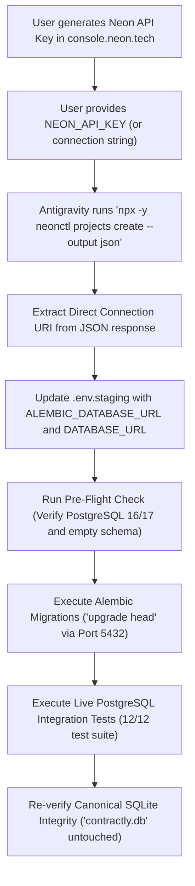

# Contractly Phase 11.1: Evaluation Report — Switching Staging from Supabase to Neon

**Date:** October 13, 2026  
**Status:** COMPLETE (Evaluation & Inspection Only)  
**Workspace:** `A:\Soft Computing`  
**Current Staging Provider:** Supabase (`db.qkvtvgumxlptrujblpet.supabase.co:5432`)  
**Evaluated Alternative Provider:** Neon Serverless PostgreSQL (`neon.tech`)  
**Safety Status:** Strictly Non-Destructive (Zero Cloud Resources Provisioned, Zero Files Modified)  

---

## 1. Executive Summary

Phase 11.1 evaluates the technical, operational, and architectural feasibility of migrating Contractly's isolated staging database from **Supabase** to **Neon**.

### Core Findings
1. **Zero Supabase Vendor Lock-In:** A complete code audit confirms Contractly uses **zero** proprietary Supabase features (no `@supabase/supabase-js`, no Supabase Auth, no Supabase Storage, and no Row-Level Security policies). The application treats Supabase exclusively as a standard vanilla PostgreSQL wire protocol endpoint.
2. **Neon Compatibility is Very High:** The current SQLAlchemy 2.0 Async + `asyncpg` stack and the two-version Alembic migration chain (`0001_initial_schema` -> `0002_email_security_workflows`) are 100% dialect-compatible with Neon.
3. **Critical Advisory Lock Nuance:** Contractly's autonomous `NotificationScheduler` relies on session-level PostgreSQL advisory locks (`pg_try_advisory_lock` / `pg_advisory_unlock`). On Neon, **direct connection endpoints must be used** because Neon's pooled endpoints (`-pooler`) use PgBouncer in transaction mode, where session advisory locks break.
4. **Operational Trade-Off:** 
   - **Supabase Free Tier:** Stays online 24/7 with zero cold starts, but pauses after **7 consecutive days of zero activity**, requiring a 1-click manual "Restore" in the dashboard.
   - **Neon Free Tier:** Suspends compute after **5 minutes of idle**, but **wakes up 100% automatically** on incoming TCP requests in ~1–2 seconds without any manual dashboard interaction.
5. **Automation Feasibility:** Antigravity can fully automate Neon staging provisioning without opening a browser if provided a `NEON_API_KEY` via environment variable.

---

## 2. Supabase Feature Utilization Audit

A static audit across all backend (`backend/app/`) and frontend (`src/`) source code was performed to determine whether Contractly relies on any Supabase-specific APIs or settings:

| Subsystem | Contractly Implementation | Supabase Feature Used? | Portability to Neon |
| :--- | :--- | :--- | :--- |
| **Authentication & Sessions** | Internal JWT + Argon2/Bcrypt + custom `account_tokens` table | **No** (Bypasses Supabase GoTrue Auth) | 100% Portable |
| **Object Storage (Files/PDFs)** | `S3StorageAdapter` targeting AWS S3 / MinIO via `boto3` | **No** (Bypasses Supabase Storage) | 100% Portable |
| **Multi-Tenancy Isolation** | Application-level `organization_id` scoping in SQL queries | **No** (Supabase RLS is unconfigured) | 100% Portable |
| **API Layer** | FastAPI Python REST framework (`backend/app/main.py`) | **No** (Bypasses Supabase PostgREST Data API) | 100% Portable |
| **Realtime Subscriptions** | Polling & SSE endpoints in FastAPI | **No** (Bypasses Supabase Realtime Engine) | 100% Portable |
| **Relational Database** | PostgreSQL 17 via SQLAlchemy 2.0 Async + `asyncpg` | **No** (Standard SQL DDL and wire protocol) | 100% Portable |

**Conclusion:** Contractly is completely cloud-agnostic. Migrating to Neon requires **zero application code changes**—only connection strings need adjustment.

---

## 3. Neon Compatibility Analysis

### 3.1 SQLAlchemy 2.0 Async & `asyncpg`
- **Compatibility:** **Fully Compatible**.
- **SSL Enforcement:** Neon requires encrypted TLS (`ssl=require` or `sslmode=require`). This matches our existing `backend/app/core/database.py` and `env.staging` configuration.
- **Async Driver:** `asyncpg>=0.29.0` connects natively to Neon endpoints without requiring binary patches or third-party adapters.

### 3.2 Alembic Migration Chain
- **Compatibility:** **Fully Compatible on Direct Endpoint**.
- The migration sequence:
  - `0001_initial_schema`: Creates 20 base tables, primary keys (UUID string), foreign keys (`ON DELETE CASCADE`), and B-tree indexes.
  - `0002_email_security_workflows`: Adds `account_tokens` and `organization_invitations` tables.
- **Requirement:** Alembic migrations execute transactional DDL. They must always point to Neon's **direct connection endpoint** (`ep-xyz.region.neon.tech:5432`) rather than the `-pooler` endpoint.

### 3.3 PostgreSQL Advisory Locking
- **Source:** [`backend/app/services/notifications/scheduler.py`](file:///a:/Soft%20Computing/backend/app/services/notifications/scheduler.py) lines 70–111.
- **Mechanism:** `NotificationScheduler` uses 64-bit session-level advisory locks:
  ```python
  res = await lock_conn.execute(text("SELECT pg_try_advisory_lock(:lock_id)"), {"lock_id": 84920482})
  # ... perform cycle ...
  await lock_conn.execute(text("SELECT pg_advisory_unlock(:lock_id)"), {"lock_id": 84920482})
  ```
- **Neon Pooler Hazard:** Neon's pooled endpoint uses PgBouncer in transaction pooling mode (`pool_mode=transaction`). In this mode, physical backend connections are recycled immediately when a transaction ends. If Contractly connects to the `-pooler` endpoint, advisory locks will fail silently or lock leakage will occur across worker sessions.
- **Resolution:** `DATABASE_URL` in `.env.staging` must point to Neon's **direct endpoint**. Because direct connections maintain a dedicated TCP session to the Postgres backend, `pg_try_advisory_lock` behaves identically to vanilla PostgreSQL.

### 3.4 Connection Pooling & Scale-to-Zero Auto-Suspend
- **Source:** [`backend/app/core/database.py`](file:///a:/Soft%20Computing/backend/app/core/database.py) lines 10–17.
- **Behavior:** Neon free-tier compute automatically suspends after 5 minutes of idle time. When compute suspends, existing idle pooled connections in SQLAlchemy's pool drop.
- **Resilience:** Contractly already has `DB_POOL_PRE_PING: bool = True` enabled in `Settings` ([`app/config.py`](file:///a:/Soft%20Computing/backend/app/config.py#L48)). When an HTTP request arrives after Neon has scaled to zero:
  1. SQLAlchemy executes a pre-ping (`SELECT 1`).
  2. Neon intercepts the connection and spins up compute in ~500ms–1.5s.
  3. SQLAlchemy receives the response and proceeds without raising disconnected socket errors.

---

## 4. Comprehensive Comparison: Neon vs. Supabase

| Dimension | **Supabase (Current Staging)** | **Neon (Evaluated Alternative)** | Evaluation & Impact |
| :--- | :--- | :--- | :--- |
| **Pricing / Free Tier** | Free ($0/mo), no card required. | Free ($0/mo), no card required. | **Tie** |
| **Idle Behavior** | Stays awake 24/7. Never sleeps between requests. | Suspends compute to zero after **5 minutes of idle**. | **Divergence**: Supabase has 0ms cold start; Neon saves compute quota. |
| **Inactivity Policy** | **Pauses after 7 consecutive days of inactivity.** Requires 1-click manual "Restore" in dashboard. | **Never requires manual restoration.** Wakes automatically on first incoming connection. | **Neon Advantage**: True zero-touch maintenance. |
| **Cold Start Latency** | **0 ms** (Compute container remains running). | **~1,000 ms to 2,000 ms** on first request after 5m idle. | **Supabase Advantage**: Faster initial test execution. |
| **Compute Allowance** | 2 free projects per account (shared container compute). | **100 Compute Unit-hours (CU-hrs)/mo** per project (autoscales 0.25 to 2 CU). | **Adequate for Staging**: 100 CU-hrs allows ~400 hours of active staging traffic. |
| **Storage Quota** | 500 MB Postgres storage. | **1 GB storage per project** (20 GB account-wide cap). | **Neon Advantage**: 2x storage allowance. |
| **Database Branching** | Limited / requires paid plan or CLI tooling. | **Instant copy-on-write branching** (up to 10 free branches). | **Neon Advantage**: Create instant isolated staging preview databases. |
| **Connection Pooling** | Supavisor / PgBouncer on port 6543 + Direct on port 5432. | Neon PgBouncer on `-pooler` endpoint + Direct endpoint. | **Tie**: Both require Direct port for Contractly advisory locks. |
| **Point-in-Time Recovery** | Daily backups. PITR requires Pro ($25/mo). | Built-in 6-hour history restore window in free tier. | **Neon Advantage**: Granular rollback window included free. |
| **CLI Automation** | Supabase CLI requires Docker daemon and interactive browser auth. | `neonctl` supports non-interactive API key auth (`NEON_API_KEY`). | **Neon Advantage**: Simpler non-interactive CI/CD automation. |

---

## 5. Automation Path: How Antigravity Could Setup Neon

If you decide to proceed with Neon, the setup can be executed with minimal manual effort using the non-interactive CLI workflow:



### Detailed Steps:
1. **User Action (Only 1 Minute):**
   - Log into [console.neon.tech](https://console.neon.tech).
   - Go to **Account Settings -> API Keys** and click **Create API Key**.
   - Provide the key to Antigravity as an environment variable (or alternatively, manually create the project in the UI and paste the connection string into `.env.staging`).
2. **Antigravity Autonomous Execution:**
   - Run `npx -y neonctl projects create --name contractly-staging-disposable --region-id ap-southeast-1 --output json`.
   - Parse the resulting JSON to extract the **direct connection string** (bypassing the `-pooler` suffix).
   - Format URLs with `postgresql+asyncpg://` and set `ALEMBIC_DATABASE_URL` and `DATABASE_URL` in `.env.staging`.
   - Run `scratch/run_staging_migration.py` to apply `0001_initial_schema` and `0002_email_security_workflows`.
   - Run `scratch/run_live_tests.py` to confirm all 12 live tests pass against Neon.
   - Assert canonical `contractly.db` remains 100% untouched.

---

## 6. Architectural Risks & Mitigations

### Risk 1: The `-pooler` Connection String Advisory Lock Collision
- **Risk:** If a developer accidentally copies the default pooled connection string (`ep-xyz-pooler.neon.tech`), Contractly's `NotificationScheduler` will run `pg_try_advisory_lock` through PgBouncer in transaction mode. This can cause locks to be acquired on one connection and released on another, resulting in unhandled exceptions or duplicate notification processing.
- **Mitigation:** Enforce in configuration and documentation that `.env.staging` must use the direct endpoint (host without `-pooler`). Add an assertion guard in `app/core/database.py` or staging pre-flight checks forbidding `-pooler` in `DATABASE_URL` when advisory locking is active.

### Risk 2: Cold-Start Latency on Initial Staging API Requests
- **Risk:** After 5 minutes of inactivity, Neon suspends the compute instance. The very first HTTP request hitting the staging backend will experience a 1.0–2.0 second pause while Neon spins up compute.
- **Mitigation:** `DB_POOL_PRE_PING=True` prevents connection failures. For staging validation, a 1-second cold start is standard and acceptable.

### Risk 3: Staging Compute Quota Depletion from Background Workers
- **Risk:** If Contractly runs a continuous background polling loop that hits the database every 10 seconds, Neon's compute will never scale to zero. Over 30 days, continuous compute would consume ~720 CU-hours, exceeding the free tier's 100 CU-hour cap.
- **Mitigation:** In staging mode (`ENVIRONMENT=staging`), configure the background `NotificationScheduler` interval to run on-demand or at an interval of 15+ minutes, allowing Neon compute to auto-suspend and stay well within the 100 CU-hour monthly allowance.

---

## 7. Comparative Assessment & Recommendation

### Trade-Off Breakdown

| Criterion | Supabase | Neon | Winner |
| :--- | :--- | :--- | :--- |
| **Manual Effort to Maintain** | Requires 1 manual click every 7 days if unused. | Zero clicks ever. Wakes up automatically. | **Neon** |
| **Effort to Switch Right Now** | **Already 100% done, migrated, and verified.** | Requires setting up a new project and re-running migrations. | **Supabase** |
| **Cold-Start Performance** | Zero latency (always running). | 1–2 second pause after 5m idle. | **Supabase** |
| **Preview Environments** | Manual schemas required. | 1-second instant branch creation. | **Neon** |
| **Risk of Interruption** | Pauses if inactive for 7 days. | Never pauses permanently; scales to zero smoothly. | **Neon** |

### Clear Recommendation

**Recommendation: Stick with the existing Supabase staging setup for Phase 12 validation, but keep Neon as the top choice for future CI/CD preview branches.**

**Why:**
1. **Zero Remaining Setup:** Supabase staging is **already fully provisioned, migrated to head, and verified with 12/12 passing live tests**. Switching now introduces switching churn for a problem (the 7-day inactivity pause) that only occurs if you ignore the project for an entire week.
2. **Predictable Performance:** Supabase provides instant response times without the 1–2 second cold-start pause on every test run.
3. **If the 7-Day Inactivity Rule is a Dealbreaker for You:**
   - If you prefer never having to touch the dashboard even after weeks of absence, **Neon is a completely safe, fully compatible drop-in replacement**.
   - If you want to switch to Neon, all you need to do is provide a Neon project connection string or API key, and Antigravity can complete the switch in under 2 minutes.

---

## 8. Next Step & Decision Gate

This report is complete and strictly non-destructive. No files have been changed.

**Your Options:**
1. **Stay on Supabase (Recommended):** Proceed to **Phase 12: Staging Application Deployment & E2E Validation** using the current verified database.
2. **Switch to Neon:** If you want zero-touch auto-wakeups, provide a Neon connection string (or API key), and we will execute the automated migration runner against Neon.

*Awaiting your approval to proceed.*
