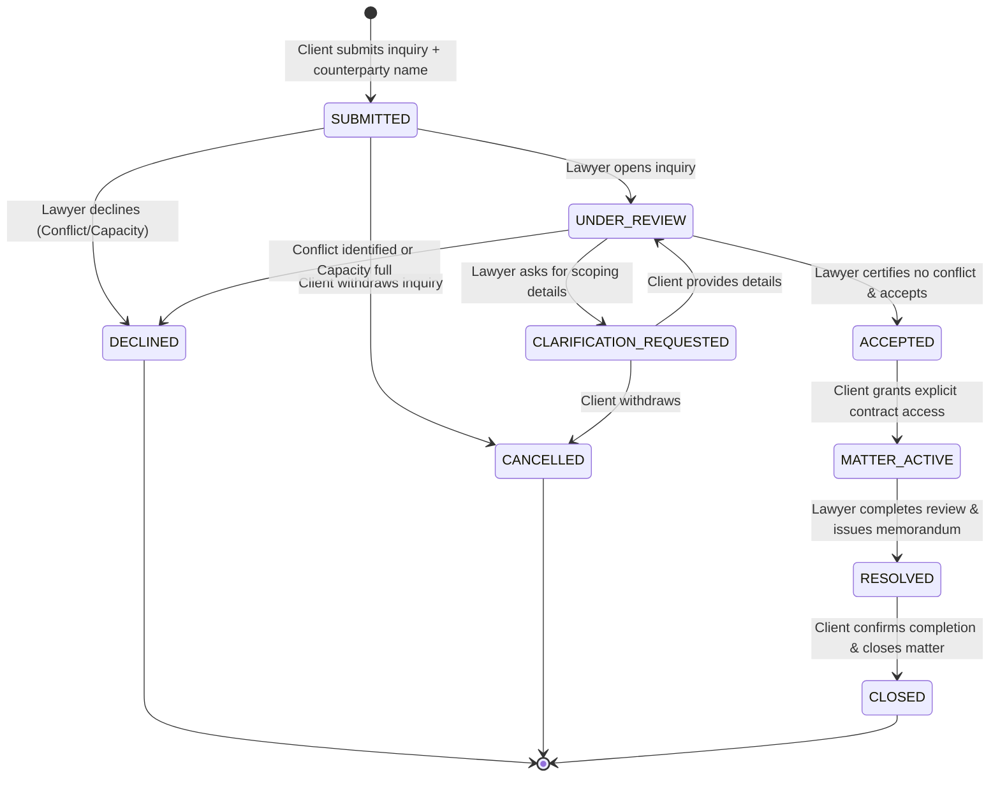
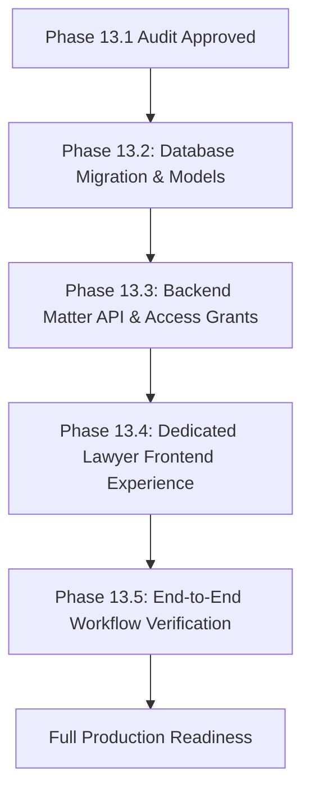

# Contractly Phase 13.1: Lawyer Dashboard and Role-Based Workflow Audit Report

**Date:** October 14, 2026  
**Auditor:** Antigravity Autonomous Pair Programming Agent  
**Environment Audited:** Contractly Platform (FastAPI Async Backend + Next.js 14 App Router + Neon PostgreSQL Staging + SQLite Canonical Database + SQLAlchemy / Alembic)  
**Safety Status:** Strictly Read-Only Audit. Zero application code or database schemas modified. Zero environment variables altered. All databases, migrations, and documents preserved.

---

## Executive Summary

Contractly currently provides enterprise contract lifecycle management (CLM) for business organizations (`account_type="BUSINESS"`) and personal users (`account_type="INDIVIDUAL"`). While the application includes initial references to legal professionals (an `account_type="LEGAL_PROFESSIONAL"` enum option in registration and a public "Get Legal Help" advocate directory), **a dedicated lawyer dashboard and attorney-client matter collaboration experience is not yet implemented**.

Today, users registering as legal professionals are provisioned a standard workspace with standard CLM views simply re-labeled ("Practice Overview", "Client Contracts", "Colleague Network"). Inquiries submitted through the "Get Legal Help" directory do not create persistent matter records or notify attorneys; they only append an audit log entry in the client's tenant.

This audit establishes the comprehensive blueprint for building a secure, professional **Lawyer Experience** within Contractly that preserves:
1. **Tenant Isolation:** Client documents and lawyer practices remain in strictly segregated organizations.
2. **Explicit Matter-Level Gating:** Lawyers never gain universal access to a client tenant; contract access is granted strictly on a per-matter basis after conflict clearance and explicit client consent.
3. **Role Separation:** Lawyers are neither platform administrators nor internal business employees; platform administrators have zero access to lawyer-client legal discussions.
4. **Contractly Aesthetic Integrity:** Warm ivory (`#F7F3EA`, `#FCFAF5`) and deep olive (`#3F4634`, `#2E5230`) palette; no emojis, gradients, decorative AI badges, or fake metrics.

---

## 1. Audit of Existing Functionality

### 1.1 Existing Functionality Status Matrix

| Subsystem | Existing Implementation Status | Code Evidence | Verdict / Gap |
| :--- | :--- | :--- | :--- |
| **Account Type & Registration** | **Implemented** (Backend & Frontend) | `backend/app/schemas/auth.py` (L14, L45), `backend/app/api/v1/auth.py` (L154-155), `src/app/register/page.tsx` (L42-52) | Registrant can select `LEGAL_PROFESSIONAL`. Backend creates organization named `"<Name> Legal Practice"` with `account_type="LEGAL_PROFESSIONAL"`. |
| **User Roles & Permissions** | **Implemented for CLM; Missing Lawyer Roles** | `backend/app/models/user.py` (L44), `backend/app/core/permissions.py` (L30-110) | Roles are internal business roles (`OWNER`, `ADMIN`, `LEGAL_MANAGER`, `LEGAL_REVIEWER`, `PROCUREMENT`, `FINANCE`, `HR`, `EMPLOYEE`). No advocate/lawyer-specific roles. |
| **Platform Admin Separation** | **Implemented** | `backend/app/models/user.py` (L21-35), `backend/app/core/permissions.py` (L112-130), `src/app/admin/page.tsx` | Platform roles (`PLATFORM_SUPER_ADMIN`, `PLATFORM_SUPPORT`) are strictly separated from customer tenants. Platform admins have zero routine contract inspection access. |
| **Lawyer Directory UI** | **Static Mock UI** | `src/components/lawyers/lawyer-directory.tsx`, `src/lib/directory-data.ts` | Hardcoded array of 3 fictional advocates (`VERIFIED_LAWYERS`). No backend database query or pagination. |
| **Legal-Help Inquiry Submission** | **Incomplete (Audit Log Only)** | `backend/app/api/v1/lawyers.py` (L14-53), `src/lib/api-client.ts` (L851) | `POST /api/v1/lawyers/inquiries` creates an `AuditLog` row in client's tenant and returns `PENDING_COORDINATION`. **No database table exists to store inquiries.** Lawyers cannot view or respond to inquiries. |
| **Lawyer Dashboard & Views** | **Missing (Re-labeled Business Tabs)** | `src/components/navigation/sidebar.tsx` (L128-139), `src/app/page.tsx` (L166) | For `LEGAL_PROFESSIONAL`, the sidebar simply renames business tabs ("Practice Overview", "Client Contracts"). When clicked, it renders standard business components (`OverviewDashboard`, `ContractTable`). No lawyer workspace exists. |
| **Matter Lifecycle & Gating** | **Missing** | No database models or routes | No matter tracking, conflict checking, or matter-scoped document grants. |
| **Lawyer Verification** | **Static Mock Data** | `src/lib/directory-data.ts` (`verified: true`) | No bar license validation, ID upload, or admin verification flow. |
| **Consultation Scheduling** | **Static Mock Copy** | `lawyer-directory.tsx` (L15) | Hardcoded dropdown string `"Tomorrow at 3:00 PM"`. No calendar synchronization or availability slots. |
| **Attorney-Client Messaging** | **Missing** | No database models or routes | Zero messaging or clarification infrastructure. |
| **Billing & Payments** | **Not Implemented (Intentionally Omitted)** | Codebase-wide search confirmed zero Stripe / billing code | Consultation fees displayed as informational text only (`₹7,500 / 45 min`). Offline/direct payment coordination. |

### 1.2 Tenant Boundary & Contract Permissions Analysis
- **Contract Ownership:** Every `Contract` record has a non-nullable foreign key `organization_id` ([backend/app/models/contract.py](file:///A:/Soft%20Computing/backend/app/models/contract.py#L10)).
- **Query Isolation:** All contract read, write, and export endpoints in [backend/app/api/v1/contracts.py](file:///A:/Soft%20Computing/backend/app/api/v1/contracts.py) enforce:
  `Contract.organization_id == tenant.id`
- **Isolation Impact:** When a lawyer logs into their own organization (`"Advocate Radhika Legal Practice"`, `org_lawyer`), they cannot see any contracts belonging to client organizations (`"Northstar Technologies"`, `org_client`).
- **Core Requirement:** To enable lawyer contract review without breaking tenant isolation, Contractly must introduce a scoped **Matter Access Grant** (`MatterAccessGrant`) that allows an authorized attorney in `org_lawyer` to view or redline specific contract versions belonging to `org_client`, without granting membership or broader visibility in `org_client`.

---

## 2. Defined Role & Permission Model

### 2.1 The Three-Pillar Persona Separation

```
┌─────────────────────────────────────────────────────────────────────────────┐
│                           CONTRACTLY PLATFORM                               │
├───────────────────────────────┬─────────────────────────────────────────────┤
│ 1. CLIENT / BUSINESS TENANTS  │ 2. LAWYER / PRACTICE TENANTS                │
│    (account_type = BUSINESS)  │    (account_type = LEGAL_PROFESSIONAL)       │
│                               │                                             │
│  • Organization Owner         │  • Verified Advocate (Lead Counsel)         │
│  • General / Legal Counsel    │  • Associate Attorney                       │
│  • Procurement / Finance      │  • Legal Assistant / Paralegal              │
│  • Standard Employee          │                                             │
│                               │  Operates in isolated Practice Workspace.   │
│  Controls agreements, submits │  Accesses client contracts ONLY via active, │
│  inquiries, grants consent.   │  explicit, revocable Matter Grants.         │
├───────────────────────────────┴─────────────────────────────────────────────┤
│ 3. PLATFORM OPERATIONAL ADMINISTRATORS                                      │
│    (user.is_super_admin = true, platform_role = PLATFORM_SUPER_ADMIN)       │
│                                                                             │
│  • Verifies lawyer bar credentials and onboarding eligibility               │
│  • Manages system uptime, storage quotas, and aggregate telemetry           │
│  • STRICTLY BLOCKED from inspecting customer contracts or matter messages   │
└─────────────────────────────────────────────────────────────────────────────┘
```

### 2.2 Comprehensive Role-to-Permission Matrix

| Permission Key | Business Owner / Admin | In-House Legal Manager | Business Employee | Verified Advocate (Lawyer) | Associate / Assistant | Platform Administrator |
| :--- | :---: | :---: | :---: | :---: | :---: | :---: |
| `contracts:create_internal` | ✅ | ✅ | ❌ | ❌ | ❌ | ❌ |
| `contracts:read_own_tenant` | ✅ | ✅ | Own only | ❌ (Client contracts) | ❌ (Client contracts) | ❌ |
| `legal_help:submit_inquiry` | ✅ | ✅ | ✅ | ❌ | ❌ | ❌ |
| `legal_help:cancel_inquiry` | ✅ | ✅ | Own only | ❌ | ❌ | ❌ |
| `legal_help:grant_contract_access`| ✅ | ✅ | ❌ | ❌ | ❌ | ❌ |
| `matters:read_assigned` | ❌ | ❌ | ❌ | ✅ | ✅ | ❌ |
| `matters:accept_or_decline` | ❌ | ❌ | ❌ | ✅ | ❌ | ❌ |
| `matters:conflict_check` | ❌ | ❌ | ❌ | ✅ | ❌ | ❌ |
| `matters:request_info` | ❌ | ❌ | ❌ | ✅ | ✅ | ❌ |
| `matters:review_shared_contract`| ❌ | ❌ | ❌ | ✅ (Only with grant) | ✅ (Only with grant) | ❌ |
| `matters:propose_redline` | ❌ | ❌ | ❌ | ✅ | ✅ | ❌ |
| `matters:send_message` | ✅ (Client side)| ✅ (Client side)| ✅ (Author)| ✅ (Lawyer side) | ✅ (Lawyer side) | ❌ |
| `lawyer:manage_profile` | ❌ | ❌ | ❌ | ✅ | ❌ | ❌ |
| `lawyer:set_availability` | ❌ | ❌ | ❌ | ✅ | ✅ | ❌ |
| `lawyer:verify_credentials` | ❌ | ❌ | ❌ | ❌ | ❌ | ✅ |
| `platform:inspect_contract_text`| ❌ | ❌ | ❌ | ❌ | ❌ | ❌ **(FORBIDDEN)** |

---

## 3. Dedicated Lawyer User Experience Design

The Lawyer Workspace must strictly follow Contractly’s warm ivory (`#F7F3EA`, `#FCFAF5`), deep olive (`#3F4634`, `#2E5230`), and stone border (`#DED6C8`) aesthetic.

### 3.1 Design Principles & Constraints
- **Color Palette:** Warm ivory background (`#F7F3EA`), cards (`#FCFAF5`), deep olive primary (`#3F4634`), forest accent (`#2E5230`), muted stone borders (`#DED6C8`), charcoal text (`#242321`), muted captions (`#6F6A61`).
- **No Consumer Gimmicks:** Zero gradients, zero emojis, zero fake star ratings, zero decorative AI sparkles, and zero pill-shaped buttons.
- **Button Standards:** Crisp 2px border radius (`rounded-[2px]`), font size 12px (`text-xs`), uppercase tracking for technical metadata (`font-mono text-[11px]`).
- **Honest States:** Informative empty states explaining next procedural steps; no mock counters or synthetic marketing metrics.

### 3.2 Lawyer Workspace Navigation Architecture

When `accountType === 'LEGAL_PROFESSIONAL'`, the sidebar renders seven focused tabs:

```
┌────────────────────────────────────┐
│ CONTRACTLY                         │
│ ADVOCATE WORKSPACE                 │
├────────────────────────────────────┤
│ • Overview                         │
│ • Incoming Requests         [ 2 ]  │
│ • My Matters                [ 5 ]  │
│ • Contract Review                  │
│ • Calendar                         │
│ • Messages                  [ 1 ]  │
│ • Profile & Availability           │
├────────────────────────────────────┤
│ Bar Council: D/1842/2012           │
│ Status: [● VERIFIED ADVOCATE]      │
└────────────────────────────────────┘
```

### 3.3 Detailed View Specifications

#### 1. Overview Dashboard
- **Header:** Advocate name, chambers/firm affiliation, bar council verification badge, jurisdiction.
- **Metrics Grid (Honest Operational Counts):**
  - *Pending Inquiries* (Requires conflict check / response).
  - *Active Matters* (Currently open for review or redlining).
  - *Upcoming Consultations* (Confirmed appointments for the week).
  - *Pending Client Clarifications* (Awaiting client reply).
- **Recent Activity Feed:** Real-time log of client submissions, document grants, message receipts, and milestone completions.
- **Matter Workload Bar:** Capacity status indicator (e.g. `Capacity: 4 of 6 Active Matters utilized`).

#### 2. Incoming Requests (Intake Queue)
- **Table / Card List:**
  - `Reference ID` (e.g. `INQ-9482A`), Client Organization Name, Matter Category (e.g. SaaS Agreement, Commercial Lease, Non-Compete).
  - Counterparty Name (Crucial for immediate conflict checking).
  - Requested Time Slot & Client Submission Date.
  - Client Preliminary Notes (Plain text summary).
  - *Privacy Boundary Notice:* Full contract documents are masked until conflict check is passed and client confirms sharing.
- **Actions:**
  - `[Run Conflict Check]` (Opens counterparty verification modal).
  - `[Request More Information]` (Opens clarification dialogue with client).
  - `[Accept Matter]` (Prompts for consultation confirmation).
  - `[Decline Inquiry]` (Requires non-prejudicial reason: Conflict, Capacity, Out of Jurisdiction).

#### 3. My Matters (Active Docket)
- **Filter Tabs:** `All Matters`, `Under Review`, `Redlining / Negotiation`, `Ready for Sign-off`, `Closed`.
- **Matter Row Details:**
  - Matter Reference, Client Name, Client Primary Contact.
  - Linked Contract Code & Title (e.g. `CTR-2026-0842: Cloudflare Enterprise Agreement`).
  - Access Level: `READ_ONLY` or `REDLINE_COLLABORATIVE`.
  - Expiry / Notice Deadlines.
  - Status Badge with subtle border and fill (e.g. `[● ACTIVE REVIEW]`, `[● CLARIFICATION PENDING]`).
- **Quick Actions:** Open Matter Workspace, Send Client Message, Export Lawyer Summary.

#### 4. Contract Review (Specialized Lawyer Interface)
- **Split-Screen Workspace:**
  - *Left Pane (Document Viewer):* Full contract text with section indexing, clause categorization, and risk highlights.
  - *Right Pane (Lawyer Advisory Console):*
    - Tab A: **Lawyer Advisory Notes** (Private chambers notes vs. Client-visible advisory memoranda).
    - Tab B: **Redline Proposals** (Propose clause amendments, specify fallback positions, tag risk reductions).
    - Tab C: **Compliance Checklist** (Governing law, jurisdiction, liability cap alignment, termination notice enforceability).
- **Export Toolbar:** Export Clean Copy, Export Tracked Revisions (DOCX), Generate Attorney Summary Memorandum.

#### 5. Calendar & Consultations
- **View:** Monthly / Weekly agenda view showing scheduled 45-minute consultation calls.
- **Event Card:** Client Organization, Attendee Names, Video Link / Conference Dial-in (manual entry or integration), Linked Matter ID.
- **Availability Blockout:** Lawyer can toggle working hours, unavailable date ranges, and maximum daily consultation limits.

#### 6. Messages (Matter Communications)
- **Threaded Communication:** Scoped strictly per active matter.
- **Transparency Rules:** Messages are visible to the client matter team and the lawyer's chambers team.
- **Attachment Vault:** Client can attach additional exhibits; lawyer can attach formal legal opinions.
- **Disclaimer:** Prominent banner: *"Communications within this workspace are subject to attorney-client advisory guidelines. Platform administrators do not monitor message contents."*

#### 7. Profile & Availability
- **Advocate Credentials:**
  - Full Name, Firm / Chambers Name.
  - Bar Council Registration Number & State Bar Council.
  - Admitted Jurisdictions (e.g. Supreme Court of India, High Court of Delhi, Karnataka High Court).
  - Practice Area Specializations (Checklist: Corporate, Employment, Tech/SaaS, Property, DPDPA).
  - Years of Practice.
- **Public Directory Settings:**
  - Marketplace visibility toggle (`Accepting Inquiries: ON/OFF`).
  - Standard Advisory Consultation Fee (e.g. `₹7,500 / 45 min`).
  - Verification Status Card: Shows verified status or instructions for document submission.

---

## 4. Legal-Help Workflow & Lifecycle State Machine

### 4.1 Strict Lifecycle State Diagram



### 4.2 State Machine Transitions & Invariants

| State | Allowed Transitions | Trigger / Actor | Contract Document Access Status | Mandatory Invariant |
| :--- | :--- | :--- | :--- | :--- |
| **`SUBMITTED`** | `UNDER_REVIEW`, `DECLINED`, `CANCELLED` | Client submits; Lawyer opens; Client cancels | **RESTRICTED:** Lawyer sees metadata & counterparty name ONLY. Raw file BLOCKED. | Prevents exposure of confidential contracts prior to conflict checks. |
| **`UNDER_REVIEW`** | `CLARIFICATION_REQUESTED`, `ACCEPTED`, `DECLINED` | Lawyer evaluates counterparty & matter scope | **RESTRICTED:** Document text blocked. | Lawyer must certify conflict clearance before acceptance. |
| **`CLARIFICATION_REQUESTED`** | `UNDER_REVIEW`, `CANCELLED` | Lawyer posts scoping question; Client replies | **RESTRICTED:** Document text blocked. | All scoping queries tracked in matter audit trail. |
| **`DECLINED`** | *Terminal* | Lawyer rejects request | **NO ACCESS** | Reason logged (`CONFLICT_OF_INTEREST`, `CAPACITY_FULL`, `OUT_OF_SCOPE`). |
| **`CANCELLED`** | *Terminal* | Client cancels request | **NO ACCESS** | Permitted anytime prior to `ACCEPTED`. |
| **`ACCEPTED`** | `MATTER_ACTIVE`, `CANCELLED` | Lawyer confirms slot; Awaiting client consent | **PENDING CONSENT:** Access grant ready but inactive. | Client must click "Authorize Contract Sharing" to activate. |
| **`MATTER_ACTIVE`** | `RESOLVED` | Client authorizes contract; Matter workspace active | **AUTHORIZED:** Active `MatterAccessGrant` permits reading & redlining. | Lawyer operations emit audit events in client tenant. |
| **`RESOLVED`** | `CLOSED`, `MATTER_ACTIVE` | Lawyer uploads final opinion or redline package | **AUTHORIZED (Read-Only)** | Work is delivered; client has 7 days to request follow-up. |
| **`CLOSED`** | *Terminal* | Client signs off or 14-day auto-archive triggers | **ARCHIVED / REVOKED:** Document grant revoked or locked read-only. | Retained for regulatory legal audit requirements. |

### 4.3 Mandatory Conflict-Check Protocol
1. When a client submits an inquiry, they must supply the **Opposing Party / Counterparty Name** (e.g. `"Acme Cloud Services Ltd."`).
2. The lawyer cannot click `[Accept]` until they check an explicit attestation:
   `[✓] I certify that I have conducted an internal conflict-of-interest check and that neither I nor my firm represents the adverse party in this matter.`
3. If an adverse relationship exists, the lawyer clicks `[Decline Matter]` and selects `"Conflict of Interest"`. The client is notified immediately that the advocate cannot accept the engagement due to ethical professional conduct rules, without disclosing confidential details.

### 4.4 Explicit Client Consent Gate
1. Accepting an inquiry **does not** automatically transmit the agreement file.
2. Upon advocate acceptance, the client receives an alert:
   *"Advocate Radhika Swaminathan has cleared conflicts and accepted your inquiry. Please confirm you authorize sharing CTR-2026-0842 with Swaminathan & Chambers for the duration of this matter."*
3. Only upon the client clicking `[Confirm & Share Document]` is a `MatterAccessGrant` created.

---

## 5. Security Architecture & Data Model

### 5.1 Proposed Relational Database Models

To support this workflow without modifying any existing tables or disturbing canonical SQLite and Neon staging data, a new migration (`0003_lawyer_matter_workflows.py`) will create five dedicated tables:

```
┌─────────────────────────┐          ┌──────────────────────────┐
│     lawyer_profiles     │          │      legal_matters       │
├─────────────────────────┤          ├──────────────────────────┤
│ id (PK)                 │          │ id (PK)                  │
│ user_id (FK -> users)   │          │ matter_code (e.g. MAT-..)│
│ organization_id (FK)    │◄────┐    │ client_organization_id   │
│ bar_council_number      │     │    │ lawyer_organization_id   │
│ state_bar_council       │     ├────┤ lawyer_user_id (FK)      │
│ admitted_jurisdictions  │     │    │ client_user_id (FK)      │
│ practice_areas (JSON)   │     │    │ contract_id (FK -> ctr)  │
│ experience_years        │     │    │ status (ENUM)            │
│ consultation_fee        │     │    │ counterparty_name        │
│ verification_status     │     │    │ conflict_cleared (BOOL)  │
│ verified_at             │     │    │ client_consent_at        │
│ verified_by (FK)        │     │    │ preferred_time_slot      │
└─────────────────────────┘     │    │ client_notes             │
                                │    │ resolved_at              │
                                │    └─────────────┬────────────┘
                                │                  │ 1
                                │                  │
                                │                  ▼ *
┌─────────────────────────┐     │    ┌──────────────────────────┐
│   lawyer_availability   │     │    │   matter_access_grants   │
├─────────────────────────┤     │    ├──────────────────────────┤
│ id (PK)                 │     │    │ id (PK)                  │
│ lawyer_user_id (FK)     ├─────┘    │ matter_id (FK)           │
│ day_of_week (0-6)       │          │ contract_id (FK)         │
│ start_time (HH:MM)      │          │ lawyer_user_id (FK)      │
│ end_time (HH:MM)        │          │ permission_level (ENUM)  │
│ is_active (BOOL)        │          │ is_active (BOOL)         │
└─────────────────────────┘          │ granted_at               │
                                     │ revoked_at               │
                                     └──────────────────────────┘
                                                   │ 1
                                                   │
                                                   ▼ *
                                     ┌──────────────────────────┐
                                     │     matter_messages      │
                                     ├──────────────────────────┤
                                     │ id (PK)                  │
                                     │ matter_id (FK)           │
                                     │ sender_user_id (FK)      │
                                     │ sender_type (CLIENT/LWYR)│
                                     │ message_text (TEXT)      │
                                     │ is_internal_note (BOOL)  │
                                     │ attachments_json         │
                                     │ created_at               │
                                     └──────────────────────────┘
```

#### Detailed Model Specifications
1. **`LawyerProfile` (`lawyer_profiles`)**
   - Stores professional credentials, bar enrollment ID, practice areas, bio, and operational availability.
   - `verification_status`: `PENDING_REVIEW`, `VERIFIED`, `REJECTED`, `SUSPENDED`.
   - Only `VERIFIED` lawyers are indexed in the public directory and eligible to receive client inquiries.
2. **`LegalMatter` (`legal_matters`)**
   - The central lifecycle entity linking `client_organization_id` to `lawyer_organization_id`.
   - Stores state machine status, counterparty name, conflict certification timestamps, and client consent timestamps.
3. **`MatterAccessGrant` (`matter_access_grants`)**
   - Explicit cross-tenant authorization token.
   - Authorizes a specific `lawyer_user_id` to access `contract_id` versions with permission `READ_ONLY` or `REDLINE_SUGGEST`.
   - Can be revoked at any time by the client organization owner.
4. **`MatterMessage` (`matter_messages`)**
   - Secure audit-logged communication between client and lawyer.
   - Includes flag `is_internal_note` (allows attorneys to record private legal notes invisible to the client).
5. **`LawyerAvailability` (`lawyer_availability`)**
   - Manages weekly consultation windows and blackout periods.

---

### 5.2 Proposed Backend REST API Specifications

```
Prefix: /api/v1/matters
Tags: ["Legal Matters & Advocate Collaboration"]

# Client & Public Inquiries
POST   /api/v1/lawyers/inquiries                    # Submit new legal consultation inquiry
GET    /api/v1/lawyers/directory                    # List verified public advocates (with search & filters)
GET    /api/v1/lawyers/profile                      # Get own advocate profile (Lawyer only)
PUT    /api/v1/lawyers/profile                      # Update chambers info & availability (Lawyer only)

# Matter Management & Workflow
GET    /api/v1/matters                              # List matters (Client sees own; Lawyer sees assigned)
GET    /api/v1/matters/{id}                         # Get matter details & status
PATCH  /api/v1/matters/{id}/status                  # Execute state transition (Accept, Decline, Clarify, Resolve)
POST   /api/v1/matters/{id}/conflict-check          # Lawyer certifies conflict clearance
POST   /api/v1/matters/{id}/consent                 # Client authorizes contract document sharing
POST   /api/v1/matters/{id}/cancel                  # Client withdraws inquiry

# Cross-Tenant Document Access
GET    /api/v1/matters/{id}/documents               # List authorized contract documents for matter
GET    /api/v1/matters/{id}/documents/{version_id}  # Securely stream authorized contract file
POST   /api/v1/matters/{id}/redlines                # Lawyer submits suggested redlines on matter

# Secure Messaging
GET    /api/v1/matters/{id}/messages                # Retrieve threaded matter messages
POST   /api/v1/matters/{id}/messages                # Post new client/attorney message or document attachment

# Platform Administrative Verification
GET    /api/v1/platform/lawyers/pending             # List advocates awaiting credential verification
POST   /api/v1/platform/lawyers/{id}/verify         # Approve or reject advocate bar credentials
```

### 5.3 Authorization & Security Rules
1. **Matter Verification Dependency:**
   Every matter endpoint invokes a dependency `get_authorized_matter(matter_id, current_user, tenant)`. The user is authorized if and only if:
   - `tenant.id == matter.client_organization_id` (User is an authorized member of the client tenant), OR
   - `tenant.id == matter.lawyer_organization_id` AND `current_user.id == matter.lawyer_user_id` (User is the assigned lawyer).
2. **Document Streaming Gating:**
   `GET /api/v1/matters/{id}/documents/{version_id}` checks `matter_access_grants`:
   - Checks that `matter.status == 'MATTER_ACTIVE'`.
   - Checks that `grant.is_active == True` and `grant.lawyer_user_id == current_user.id`.
   - If missing or revoked, raises `HTTP 403 Forbidden: Contract document access has not been granted by the client organization.`
3. **Tamper-Proof Audit Logging:**
   Every transition (`INQUIRY_SUBMITTED`, `CONFLICT_CLEARED`, `MATTER_ACCEPTED`, `CONSENT_GRANTED`, `MATTER_RESOLVED`) generates **two** `AuditLog` rows:
   - One in the client's organization audit log.
   - One in the lawyer's organization audit log.
4. **Data Isolation Invariant:**
   A lawyer can never execute arbitrary SQL queries against `contracts` or list all agreements of a client. Access is strictly parameterized through the join on `matter_access_grants`.

---

## 6. Security Risks & Mitigation Strategies

| Risk Description | Threat Vector | Severity | Architectural Mitigation |
| :--- | :--- | :--- | :--- |
| **Pre-Conflict Document Leak** | Client uploads proprietary trade secrets or unannounced deal terms; lawyer has a conflict with counterparty. | **Critical** | Strict two-phase disclosure: Full document text is **not accessible** during `SUBMITTED` or `UNDER_REVIEW`. Only counterparty name and client notes are visible until conflict check is certified and client grants consent. |
| **Cross-Tenant Horizontal Escalation** | Rogue attorney attempts to query `/api/v1/contracts/{id}` of a client directly. | **Critical** | Contract endpoints strictly enforce `Contract.organization_id == tenant.id`. Matter endpoints strictly verify active `MatterAccessGrant`. No direct ID-based bypass is possible. |
| **Unverified Practitioner Impersonation** | Bad actor registers as `LEGAL_PROFESSIONAL` and solicits confidential corporate agreements. | **High** | Legal professionals cannot be listed in the public directory or receive client inquiries until a Platform Super Admin verifies their Bar Council ID and sets `verification_status="VERIFIED"`. |
| **Stale Access Retention** | Matter completes or is closed, but lawyer retains permanent download access to confidential contract files. | **High** | Closing a matter automatically sets `MatterAccessGrant.is_active = False` and `revoked_at = utc_now()`. File streaming endpoints immediately return `HTTP 403`. |
| **Attorney-Client Privilege Leakage** | Platform administrators view confidential lawyer-client legal strategy messages. | **High** | Platform admin routes (`/api/v1/platform/*`) do not provide access to `matter_messages` or matter document contents. Admin role is strictly restricted to platform operational health. |

---

## 7. Phased Implementation Sequence

To implement this architecture safely, the work should follow four isolated phases:



### Phase 13.2: Data Model & Schema Migration
1. Define SQLAlchemy models in `backend/app/models/lawyer.py` (`LawyerProfile`, `LegalMatter`, `MatterAccessGrant`, `MatterMessage`, `LawyerAvailability`).
2. Generate Alembic migration `0003_lawyer_matter_workflows.py`.
3. Test migration upgrade and downgrade on isolated test databases.
4. Confirm zero regression on existing SQLite database (`contractly.db`) and Neon staging database.

### Phase 13.3: Backend APIs & Workflow Engine
1. Implement `backend/app/api/v1/matters.py` with full state machine transitions and conflict check logic.
2. Update `backend/app/api/v1/lawyers.py` to support real profile updates and directory queries against `LawyerProfile`.
3. Implement matter document streaming with `MatterAccessGrant` validation.
4. Add comprehensive automated tests in `backend/tests/test_lawyer_matter_workflows.py`.

### Phase 13.4: Lawyer Workspace Frontend Components
1. Create `src/components/lawyer/` components:
   - `lawyer-overview.tsx` (Operational dashboard & honest metrics).
   - `incoming-requests.tsx` (Queue, conflict check modal, accept/decline dialogs).
   - `my-matters.tsx` (Matter docket and status trackers).
   - `lawyer-review-studio.tsx` (Contract viewer with lawyer advisory notes pane).
   - `matter-messages.tsx` (Threaded client communications).
   - `lawyer-profile-settings.tsx` (Bar credentials & availability).
2. Update `src/components/navigation/sidebar.tsx` and `src/app/page.tsx` to conditionally mount the Lawyer Workspace when `accountType === 'LEGAL_PROFESSIONAL'`.
3. Update `src/components/lawyers/lawyer-directory.tsx` to fetch real verified attorneys from backend.

### Phase 13.5: End-to-End Multi-Tenant Verification
1. Run automated cross-tenant security tests:
   - Verify client can submit inquiry to lawyer.
   - Verify lawyer cannot access document before conflict check and client consent.
   - Verify lawyer can review and submit redlines once matter is active.
   - Verify revoking access immediately cuts off document streaming.
   - Verify platform admin cannot read matter messages.

---

## 8. Required Verification Tests

| Test Suite / Script | Verification Target | Expected Assertion |
| :--- | :--- | :--- |
| `test_lawyer_registration.py` | Registration as `LEGAL_PROFESSIONAL` | User created; Organization created with `account_type="LEGAL_PROFESSIONAL"`; `LawyerProfile` initialized in `PENDING_REVIEW`. |
| `test_lawyer_verification_gate.py` | Verification requirement for directory | Unverified lawyer omitted from `/api/v1/lawyers/directory`; cannot accept inquiries. |
| `test_matter_lifecycle_transitions.py` | State machine transitions | `SUBMITTED -> UNDER_REVIEW -> ACCEPTED -> MATTER_ACTIVE -> RESOLVED -> CLOSED`. Disallowed transitions raise HTTP 400. |
| `test_conflict_check_enforcement.py` | Conflict clearance invariant | Attempting to transition to `ACCEPTED` without `conflict_cleared=True` raises HTTP 422. |
| `test_cross_tenant_document_gating.py` | Document confidentiality | Lawyer querying `GET /api/v1/matters/{id}/documents/{vid}` before client consent returns HTTP 403; returns HTTP 200 with document bytes after consent. |
| `test_access_grant_revocation.py` | Access cutoff upon closing | Transitioning matter to `CLOSED` sets `is_active=False`; subsequent document requests return HTTP 403. |
| `test_platform_admin_boundary.py` | Platform admin content isolation | Platform admin token requesting `GET /api/v1/matters/{id}/messages` returns HTTP 403. |

---

## 9. Conclusion & Next Steps

This audit establishes a complete, secure, and aesthetically consistent architecture for the Contractly Lawyer Experience. By decoupling tenant ownership from matter-level document access grants, Contractly can offer rich, real-time collaboration between businesses and external legal counsel while preserving strict data boundaries and professional responsibility standards.

**Safety Confirmation:** Zero application code, database records, or environment settings were altered during this audit. 

*Report completed autonomously by Antigravity. Awaiting user review and approval before proceeding with Phase 13.2 implementation.*
