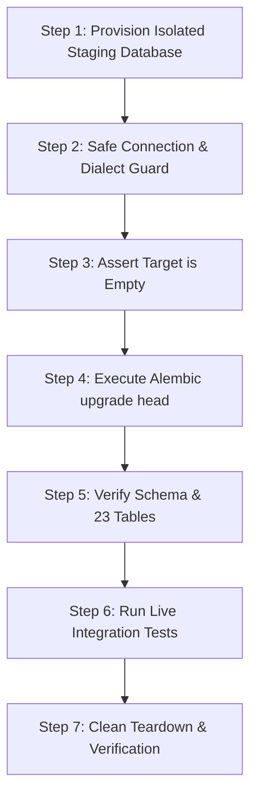

# CONTRACTLY PHASE 8: MIGRATION READINESS INVESTIGATION REPORT

**Workspace:** `A:\Soft Computing`  
**Execution Date:** 2026-10-13  
**Mode:** Strictly Read-Only Investigation (Zero Code, Schema, Database, or Data Mutations)  

---

## Executive Summary

This investigation evaluates the database migration architecture, schema reconciliation, and procedures required to safely provision and validate a disposable PostgreSQL staging database without endangering Contractly's canonical SQLite database or its associated contract documents.

### Key Conclusions
1. **Canonical vs. Secondary Database Identified:** [contractly.db](file:///a:/Soft%20Computing/contractly.db) (598 KB) is the sole authoritative canonical database. [backend/contractly.db](file:///a:/Soft%20Computing/backend/contractly.db) (155 KB) is an inactive legacy template from early repository initialization (October 7, 2026) that is never loaded by active application code or runtime services.
2. **Schema & Migration Chain Reconciled:** 
   - [0001_initial_schema.py](file:///a:/Soft%20Computing/backend/alembic/versions/0001_initial_schema.py) defines exactly 20 tables matching all 20 tables in [contractly.db](file:///a:/Soft%20Computing/contractly.db).
   - [0002_email_security_workflows.py](file:///a:/Soft%20Computing/backend/alembic/versions/0002_email_security_workflows.py) defines 2 tables (`account_tokens` and `organization_invitations`), bringing the total model table count in [backend/app/models/](file:///a:/Soft%20Computing/backend/app/models/) to 22.
   - The canonical SQLite database has no `alembic_version` table because it was initialized before Alembic was introduced, and safety controls have strictly prevented running live migrations against canonical data.
3. **Fresh PostgreSQL Migration Feasibility:** A fresh installation on a disposable PostgreSQL target via `alembic upgrade head` is **SAFE and fully supported**. Offline dialect generation (`--sql`) confirms clean transactional DDL generation (`BEGIN; ... COMMIT;`) across all 22 tables plus `alembic_version`.
4. **Existing Migration Tests Have Gaps:** Existing tests run exclusively against temporary SQLite files. They verify table existence, but do not test live PostgreSQL constraint enforcement, transactional rollbacks, schema evolution between revisions, or PostgreSQL-specific query semantics.
5. **Zero Canonical Mutation:** No code, schemas, configuration, documents, or database contents were modified during this investigation.

---

## Task A: Explanation of the Two SQLite Databases

### 1. Database Identification & Physical Resolution

| Database File | Absolute Path | Size (Bytes) | Last Modified (UTC) | SHA-256 Checksum | Role |
| :--- | :--- | :---: | :---: | :---: | :--- |
| `contractly.db` | `A:\Soft Computing\contractly.db` | 598,016 | 2026-10-13T15:20:17Z | `81e633e08568f74e...` | **Canonical Production/Dev Database** |
| `backend/contractly.db` | `A:\Soft Computing\backend\contractly.db` | 155,648 | 2026-10-07T15:19:45Z | `105525662a340f83...` | **Legacy Inactive Template** |

- **Physical File Independence:** `os.path.samefile(...)` is `False`. They have different sizes, schemas, hashes, and mtimes.

### 2. Code, Configuration, and Command Routing

All active runtime configuration and backend entry points explicitly resolve to the root `contractly.db`:

- **Configuration:** [backend/app/config.py](file:///a:/Soft%20Computing/backend/app/config.py#L6-L10):
  ```python
  BASE_DIR = os.path.abspath(os.path.join(os.path.dirname(__file__), "..", ".."))
  CANONICAL_DB_PATH = os.path.join(BASE_DIR, "contractly.db").replace("\\", "/")
  DATABASE_URL: str = f"sqlite+aiosqlite:///{CANONICAL_DB_PATH}"
  ```
- **Alembic Engine:** [backend/alembic/env.py](file:///a:/Soft%20Computing/backend/alembic/env.py#L32):
  Falls back to `settings.DATABASE_URL`, which targets root `contractly.db`.
- **Database Maintenance Script:** [backend/migrate_db.py](file:///a:/Soft%20Computing/backend/migrate_db.py#L12):
  `conn_sync = sqlite3.connect('../contractly.db')`
- **Restore & Backup Utility:** [backend/scripts/restore.py](file:///a:/Soft%20Computing/backend/scripts/restore.py#L30):
  `CANONICAL_DB_PATH = os.path.abspath(os.path.join(WORKSPACE_ROOT, "contractly.db"))`
- **Regression Tests:** [backend/tests/test_phase_1_infrastructure.py](file:///a:/Soft%20Computing/backend/tests/test_phase_1_infrastructure.py#L292) and [test_phase_3_postgresql_readiness.py](file:///a:/Soft%20Computing/backend/tests/test_phase_3_postgresql_readiness.py#L90) both assert `os.path.exists("contractly.db")`.

### 3. Why `backend/contractly.db` Exists & Potential Confusion
- **Origin:** Created during early repository scaffolding (2026-10-07) when development occurred directly inside `backend/`. When workspace architecture consolidated paths to root, the active database was centralized at `A:\Soft Computing\contractly.db`.
- **Audit Misattribution in Phase 6:** In `CONTRACTLY_PHASE_6_AUDIT_REPORT.md` (lines 22, 48, 287), the auditor reported running `PRAGMA integrity_check` against `backend/contractly.db`, assuming it was the active database because of its location inside `backend/`.
- **Accidental Usage Risk:** No automated scripts or application workers use `backend/contractly.db`. However, a developer running manual ad-hoc shell commands inside `backend/` could mistakenly query `backend/contractly.db` instead of the root database.
- **Recommended Correction:** Add a prominent comment in `docs/` and a note in `backend/README.md` identifying `contractly.db` at workspace root as the sole authoritative canonical database, and designating `backend/contractly.db` as an archived initial template. Per safety rules, do not rename or delete either file.

---

## Task B: Reconciliation of Migration History

### 1. Table-by-Table Schema Discrepancy Matrix

| Table Name | Defined in `0001` | Defined in `0002` | SQLAlchemy Models | Canonical DB (`contractly.db`) | Legacy DB (`backend/contractly.db`) |
| :--- | :---: | :---: | :---: | :---: | :---: |
| `organizations` | Yes | - | Yes | Yes (19 records) | Yes (0 records) |
| `departments` | Yes | - | Yes | Yes (6 records) | Yes (0 records) |
| `users` | Yes | - | Yes | Yes (17 records) | Yes (0 records) |
| `organization_members` | Yes | - | Yes | Yes (17 records) | Yes (0 records) |
| `contracts` | Yes | - | Yes | Yes (31 records) | Yes (0 records) |
| `contract_versions` | Yes | - | Yes | Yes (28 records) | Yes (0 records) |
| `contract_clauses` | Yes | - | Yes | Yes (127 records) | Yes (0 records) |
| `contract_risks` | Yes | - | Yes | Yes (31 records) | Yes (0 records) |
| `contract_approval_steps` | Yes | - | Yes | Yes (4 records) | - |
| `contract_redlines` | Yes | - | Yes | Yes (2 records) | - |
| `refresh_tokens` | Yes | - | Yes | Yes (65 records) | - |
| `audit_logs` | Yes | - | Yes | Yes (18 records) | Yes (0 records) |
| `obligations` | Yes | - | Yes | Yes (10 records) | Yes (0 records) |
| `obligation_evidence` | Yes | - | Yes | Yes (0 records) | Yes (0 records) |
| `calendar_events` | Yes | - | Yes | Yes (0 records) | - |
| `contract_notes` | Yes | - | Yes | Yes (0 records) | - |
| `vendors` | Yes | - | Yes | Yes (0 records) | - |
| `playbook_rules` | Yes | - | Yes | Yes (0 records) | - |
| `notifications` | Yes | - | Yes | Yes (0 records) | - |
| `user_notification_preferences` | Yes | - | Yes | Yes (3 records) | - |
| `account_tokens` | - | **Yes** | Yes | **Missing** | - |
| `organization_invitations` | - | **Yes** | Yes | **Missing** | - |
| `alembic_version` | - | - | - | **Missing** | **Missing** |
| **Total Table Count** | **20** | **2** | **22** | **20** | **11** |

### 2. Why `alembic_version` is Absent
`contractly.db` was originally provisioned using direct SQLAlchemy metadata initialization (`Base.metadata.create_all`) before Alembic migration tracking was integrated in Phase 3. Subsequent safety mandates strictly prohibited running Alembic `upgrade` or `stamp` commands against the canonical database to prevent accidental schema corruption. As a result, `contractly.db` operates cleanly on the underlying table schema without an Alembic tracking table.

### 3. Why `account_tokens` and `organization_invitations` are Absent
These two tables were designed in Phase 5 to support persistent email verification tokens, password reset tokens, and team invitations. Migration `0002_email_security_workflows.py` was created, and models were added to [backend/app/models/auth.py](file:///a:/Soft%20Computing/backend/app/models/auth.py). However:
- `AUTO_CREATE_TABLES = False` is enforced in `config.py`.
- No live Alembic migrations were executed against `contractly.db` in Phase 5, 6, or 7.
- In tests and local workflows, email verification and invitations used in-memory SQLite tables, leaving canonical SQLite untouched.

### 4. Fresh PostgreSQL Support vs. Stamping Assessment
- **Fresh PostgreSQL Database:** **COMPLETELY SAFE.**
  A clean PostgreSQL database upgraded from scratch via `alembic upgrade head` executes `0001` then `0002`, successfully creating all 22 tables, all primary keys, all foreign keys, and all indexes in exact topological order, followed by setting `alembic_version = '0002_email_security_workflows'`.
- **Stamping Canonical SQLite Database:** **UNSAFE & INAPPROPRIATE.**
  - If `alembic upgrade head` is run against `contractly.db` without stamping, it attempts to run `0001_initial_schema` and crashes with `table organizations already exists`.
  - Stamping `0001_initial_schema` onto `contractly.db` would write `alembic_version` to disk, directly violating read-only canonical data safety rules.
  - The SQLite database should remain as a read-only historical source of truth. Data transfer to PostgreSQL should be performed via an application data pump into an already-migrated PostgreSQL schema, rather than running Alembic migrations against SQLite.

### 5. PostgreSQL Dialect & Syntax Compatibility Analysis
Offline SQL inspection of the migration chain (`alembic upgrade head --sql`) revealed key PostgreSQL compatibility behaviors:
- **Primary Keys:** All models use client-generated `VARCHAR(36)` UUID strings. PostgreSQL creates them cleanly without auto-increment sequence dependencies.
- **Boolean Server Defaults:** Migrations declare `server_default='0'` and `'1'`. In PostgreSQL DDL, this emits `BOOLEAN DEFAULT '0'`. PostgreSQL coerces `'0'` to `false` and `'1'` to `true`. However, using native `sa.sql.expression.false()` or `server_default=sa.text('false')` is standard practice to prevent edge-case parser strictness across different PostgreSQL versions.
- **Timestamps:** Models declare `DateTime` without `timezone=True`, generating `TIMESTAMP WITHOUT TIME ZONE`. Application code in [base.py](file:///a:/Soft%20Computing/backend/app/models/base.py) forces UTC timestamps via `datetime.now(timezone.utc)`. When migrating to PostgreSQL, timestamps should either be stored as TIMESTAMPTZ or consistently inserted as naive UTC.
- **Foreign Key Constraints:** PostgreSQL enforces foreign key constraints strictly. The migration creation sequence in `0001` and `0002` follows strict topological order (`organizations` -> `users` -> `contracts` -> `contract_versions` / `contract_clauses` -> `contract_risks`).

---

## Task C: Safe PostgreSQL Staging Plan

The following step-by-step plan details how to create and validate a completely separate disposable PostgreSQL database without touching canonical SQLite.



### Step 1: Provision Isolated Database & Restricted Role
1. Connect as administrative DBA to staging PostgreSQL cluster:
   ```sql
   CREATE DATABASE contractly_staging_disposable;
   CREATE USER contractly_staging_worker WITH ENCRYPTED PASSWORD '<generated-secure-staging-password>';
   GRANT ALL PRIVILEGES ON DATABASE contractly_staging_disposable TO contractly_staging_worker;
   -- Restrict worker to public schema of disposable database only
   REVOKE ALL ON DATABASE postgres FROM contractly_staging_worker;
   ```

### Step 2: Connection Guard (No Credential Exposure & Anti-SQLite Guard)
Execute a pre-flight connection verification script that proves the target is PostgreSQL and strictly redacts credentials:
```python
from sqlalchemy.engine import make_url

url = make_url(staging_db_url)
print(f"Target Backend: {url.get_backend_name()}")
print(f"Target Host: {url.host}:{url.port}")
print(f"Target Database: {url.database}")
print(f"Driver: {url.drivername}")

# Strict Guard: Refuse to proceed if SQLite is targeted
assert url.get_backend_name() == "postgresql", "CRITICAL ERROR: Target is NOT PostgreSQL!"
assert "sqlite" not in url.drivername.lower(), "CRITICAL ERROR: SQLite driver detected!"
assert url.database == "contractly_staging_disposable", "CRITICAL ERROR: Unexpected database name!"
```

### Step 3: Assert Target Database is Empty
Before running migrations, query PostgreSQL metadata to prove no preexisting tables exist:
```sql
SELECT count(*) FROM information_schema.tables WHERE table_schema = 'public';
-- Must return 0
```

### Step 4: Apply Migrations from Scratch
Set environment variable and run Alembic upgrade:
```bash
export ALEMBIC_DATABASE_URL="postgresql+asyncpg://contractly_staging_worker:<password>@<staging-host>:5432/contractly_staging_disposable"
alembic -c backend/alembic.ini upgrade head
```

### Step 5: Verify Created Schema & Indexes
Verify that all 23 tables (22 application tables + `alembic_version`) exist:
```sql
SELECT table_name FROM information_schema.tables WHERE table_schema = 'public' ORDER BY table_name;
-- Expected: 23 tables

SELECT version_num FROM alembic_version;
-- Expected: '0002_email_security_workflows'

SELECT indexname FROM pg_indexes WHERE schemaname = 'public' AND tablename = 'notifications';
-- Expected: 'ix_notifications_deduplication_key'
```

### Step 6: Run Live PostgreSQL Integration Tests
Execute integration tests explicitly pinned to the disposable PostgreSQL database:
```bash
export DATABASE_URL="postgresql+asyncpg://contractly_staging_worker:<password>@<staging-host>:5432/contractly_staging_disposable"
export ENVIRONMENT="staging"
export AUTO_CREATE_TABLES="false"

# Run PostgreSQL readiness and tenant isolation test suites
python -m pytest backend/tests/test_phase_3_postgresql_readiness.py -v
python -m pytest backend/tests/test_tenant_isolation.py -v
python -m pytest backend/tests/test_rbac.py -v
```

### Step 7: Safe Teardown
Once testing completes, terminate connections and drop the disposable target:
```sql
SELECT pg_terminate_backend(pid) 
FROM pg_stat_activity 
WHERE datname = 'contractly_staging_disposable' AND pid <> pg_backend_pid();

DROP DATABASE contractly_staging_disposable;
DROP USER contractly_staging_worker;
```
Verify that `contractly.db` at workspace root has remained untouched with identical SHA-256 hash.

---

## Task D: Review of Migration Test Reliability

An audit of existing migration tests in [test_phase_1_infrastructure.py](file:///a:/Soft%20Computing/backend/tests/test_phase_1_infrastructure.py#L245) and [test_phase_3_postgresql_readiness.py](file:///a:/Soft%20Computing/backend/tests/test_phase_3_postgresql_readiness.py#L23) reveals significant coverage limitations:

### 1. Existing Test Capabilities
- Both tests execute `alembic upgrade head` and `downgrade base` exclusively against **temporary local SQLite files** (`test_disposable_migration.db` and `test_phase3_alembic.db`).
- They verify that the set of table names returned by `sqlite_master` matches a hardcoded list.
- They check that `contractly.db` is not modified.

### 2. Critical Gaps in the Current Test Suite
The existing tests do not exercise live database behaviors:
1. **No Incremental Upgrade Test:** There is no test that runs migration `0001`, inserts sample customer records, and then runs `0002` to verify that existing data is preserved and new tables (`account_tokens`, `organization_invitations`) are cleanly added.
2. **No Foreign-Key Constraint Enforcement Test:** SQLite does not enforce foreign keys by default in raw Python `sqlite3` connections unless `PRAGMA foreign_keys = ON` is executed. In PostgreSQL, FK constraints are always enforced. Invalid inserts that pass silently in SQLite test suites will fail in PostgreSQL.
3. **No Index & Unique Constraint Validation:** Tests do not assert that duplicate values (such as duplicate user emails, duplicate organization slugs, or duplicate notification deduplication keys) are rejected with a unique constraint violation under live DDL.
4. **No Token & Invitation Persistence Test:** No automated test validates that `AccountToken` or `OrganizationInvitation` records can be created, queried, expired, and cascaded on an Alembic-managed PostgreSQL schema.
5. **No Transactional Rollback Test:** No test verifies what happens when a migration fails mid-flight to confirm that PostgreSQL rolls back DDL transactions cleanly without leaving a half-migrated schema.
6. **No Live PostgreSQL Execution:** `test_postgresql_availability_detection` in `test_phase_3_postgresql_readiness.py` is skipped whenever an external PostgreSQL server is absent, meaning zero tests currently execute against PostgreSQL dialect in the standard local test run.

---

## Task E: Preconditions & Next Steps

### Migration Preconditions Checklist
Before executing any live migration on a disposable staging database:
- [ ] Staging PostgreSQL 15+ server is reachable via secure network boundary (VPC or TLS-encrypted endpoint).
- [ ] Connection URL uses `postgresql+asyncpg://` or `postgresql://` and is supplied exclusively via environment variables.
- [ ] Pre-flight script verifies `url.get_backend_name() == "postgresql"` and `url.database == "contractly_staging_disposable"`.
- [ ] Information schema check confirms 0 existing tables in target database.
- [ ] Canonical `contractly.db` SHA-256 baseline is recorded prior to staging run.
- [ ] No migrations or `stamp` commands are directed toward `contractly.db` or `backend/contractly.db`.

### Safety Confirmation
- Canonical database `A:\Soft Computing\contractly.db` was accessed **strictly read-only**.
- Canonical database file size (598,016 bytes), record counts, and document files (28/28 verified) were **not modified**.
- Secondary database `backend/contractly.db` was **not modified**.
- No code, migrations, models, or configurations were modified during this investigation.

---

## Recommended Next Step

**Do not deploy or execute migrations automatically.**  
The single safest next step is to create an automated, isolated migration test fixture that verifies the complete migration evolution (`0001` -> seed sample data -> `0002` -> assert data preservation) against an ephemeral SQLite database with `PRAGMA foreign_keys = ON`, before connecting to any staging PostgreSQL service.
